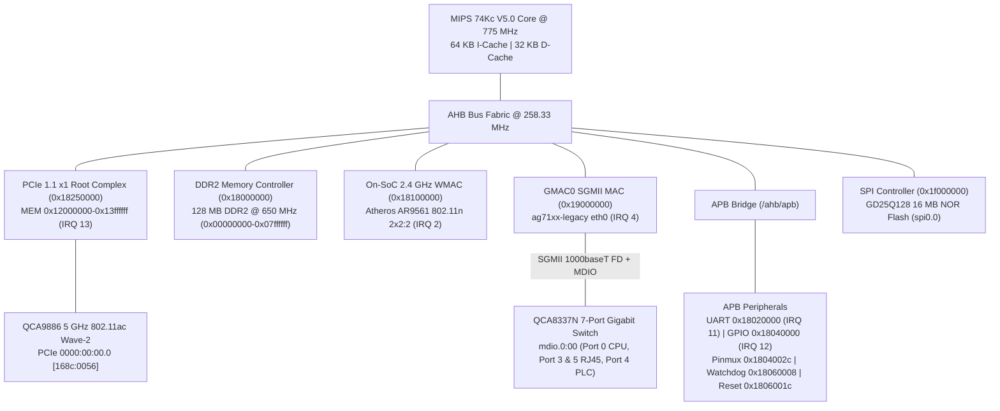
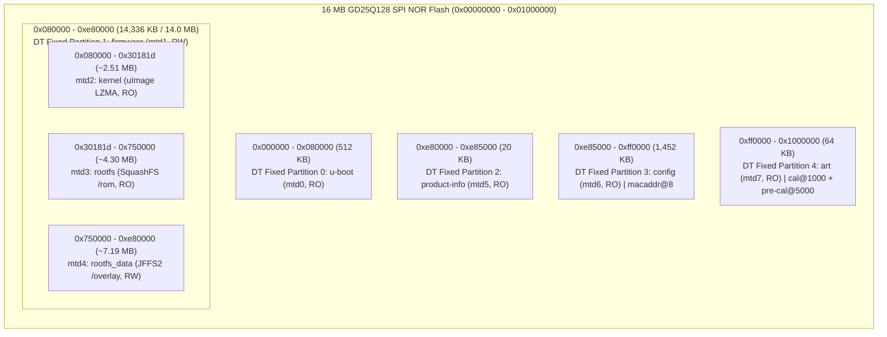
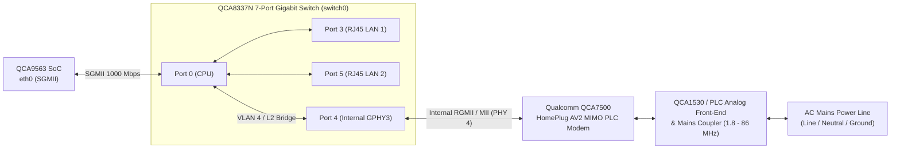

# TP-Link Deco M4R v1/v2 & P9 v2 — Hardware Silicon & Subsystem Capabilities Reference

## 1. Executive Summary & Silicon Bill of Materials (BOM)

Live hardware interrogation of a provisioned TP-Link Deco M4R v1 running OpenWrt 24.10.8 (`Linux 6.6.144`, target `ath79/generic`, profile `tplink_deco-m4r-v1`) coupled with clean-room inspection of the factory firmware image (`M4R 1.8.0 Build 20250721`) establishes the exact silicon inventory across the Deco M4R v1, Deco M4R v2, and Deco P9 v2 hardware family.

| Subsystem | Component / Part Number | Bus / Interconnect | Hardware Capabilities & Key Parameters | Linux 6.6.144 Driver / Interface |
| :--- | :--- | :--- | :--- | :--- |
| **System-on-Chip (SoC)** | Qualcomm Atheros **QCA9563-AL3A** (`QCA956X ver 1 rev 0`) | Primary SoC (Dragonfly architecture) | MIPS 74Kc V5.0 @ **775 MHz**, 64 KB I-Cache, 32 KB D-Cache, 2.4 GHz 2x2:2 WMAC, PCIe 1.1 RC, SGMII, SPI, UART, WDT, 23 GPIOs | `ath79` platform, `clk-ath79`, `pinctrl-single` |
| **System Memory (RAM)** | **128 MB DDR2** SDRAM | 16-bit DDR2 Memory Bus @ **650 MHz** | Physical range `0x00000000–0x07ffffff` (`131,072 KB`), hardware DDR write-buffer flush channels | `18000000.memory-controller` |
| **SPI NOR Flash** | GigaDevice **GD25Q128** (`JEDEC 0xc84018`) | AHB SPI (`1f000000.spi`, `spi0.0`) | **16 MB** (`16,384 KB`), 256 × 64 KB erase sectors (`erasesize = 0x10000`), stores U-Boot, OS, NVRAM, and RF ART | `spi-nor`, `mtd0`–`mtd7`, `squashfs` + `jffs2` (`overlayfs`) |
| **Gigabit Ethernet Switch** | Qualcomm Atheros **QCA8337N** (`AR8337 rev. 2`, UID `0x004dd036`) | **SGMII** (`19000000.eth`) + MDIO (`mdio.0:00`) | 7-port non-blocking Gigabit fabric (Port 0 CPU, Port 3 & 5 RJ45, Port 4 PLC on P9), 4,096 802.1Q VLANs, 1K ARL table, HW IGMPv3 snooping, Port Mirroring, 39-counter Extended MIBs, 9 KB jumbo frames | `ag71xx-legacy` (`eth0`), `ar8327` / `swconfig` (`switch0`) |
| **5 GHz Radio (`phy0`)** | Qualcomm Atheros **QCA9886** (`PCIe 168c:0056`, `qca9888 hw2.0`) | PCIe 1.1 x1 (`0000:00:00.0`, BAR0 `0x12000000`) | IEEE 802.11a/n/ac Wave-2, 2x2:2 MU-MIMO (`VHT80`), 867 Mbps PHY rate, hardware AES-CCMP/GCMP engine, DFS | `ath10k_pci` (`ath10k-ct` v10.4b-ct-9888) |
| **2.4 GHz Radio (`phy1`)** | Qualcomm Atheros **QCA9563 WMAC** (`AR9561 Rev:0`) | Internal SoC AHB (`18100000.wmac`) | IEEE 802.11b/g/n, 2x2:2 MIMO (`HT40`), 300 Mbps PHY rate, hardware AES/TKIP encryption, FFT spectral scan | `ath9k` (`mac80211` / `minstrel_ht`) |
| **Powerline Modem (Deco P9 v2)** | Qualcomm Atheros **QCA7500** | QCA8337N Switch **Port 4** (RGMII/MII) + AC Mains | HomePlug AV2 MIMO (1.8–86 MHz, 4096-QAM, 2x2 MIMO w/ beamforming), 128-bit AES-CBC hardware link crypto | Switch Port 4 L2 forwarding + `open-plc-utils` (`0x88E1` MME) |

---

## 2. System-on-Chip (SoC): Qualcomm Atheros QCA9563

### 2.1 CPU Core, ISA & Clock Hierarchy

While vendor marketing materials commonly refer to the Deco M4R processor as a "MIPS 24Kc @ 750 MHz", empirical interrogation of `/proc/cpuinfo`, `dmesg`, and `/sys/kernel/debug/clk/clk_summary` on the live silicon confirms the core is a **MIPS 74Kc V5.0** superscalar out-of-order processor clocked at **775.000 MHz**:

```text
system type             : Qualcomm Atheros QCA956X ver 1 rev 0
machine                 : TP-Link Deco M4R v1
processor               : 0
cpu model               : MIPS 74Kc V5.0 (PRId 0x00019750)
CPU clock               : 775.000 MHz
BogoMIPS                : 385.84 (lpj=1929216)
sched_clock             : 32 bits at 388MHz, resolution 2ns, wraps every 5541893118ns
wait instruction        : yes
microsecond timers      : yes
tlb_entries             : 32
extra interrupt vector  : yes
hardware watchpoint     : yes, count: 4, address/irw mask: [0x0ffc, 0x0ffc, 0x0ffb, 0x0ffb]
isa                     : mips1 mips2 mips32r1 mips32r2
ASEs implemented        : mips16 dsp dsp2
Options implemented     : tlb 4kex 4k_cache prefetch mcheck ejtag llsc dc_aliases perf_cntr_intr_bit cdmm contextconfig perf mm_full
shadow register sets    : 1
```

The SoC PLL controller (`pll-controller@18050000`) synthesizes three primary clock domains from the **25.000 MHz** crystal reference oscillator (`ref`):

| Clock Domain | Frequency | Duty Cycle | Consumers & Hardware Function |
| :--- | :--- | :--- | :--- |
| `cpu` | **775,000,000 Hz** (775.00 MHz) | 50% | MIPS 74Kc V5.0 CPU core; CP0 Count/Compare clocksource runs at `cpu / 2` (387.5 MHz) |
| `ddr` | **650,000,000 Hz** (650.00 MHz) | 50% | 16-bit DDR2 memory controller (`18000000.memory-controller`) |
| `ahb` | **258,333,333 Hz** (258.33 MHz) | 50% | High-speed internal AHB fabric (`cpu / 3`), SPI controller (`1f000000.spi`), Watchdog (`18060008.wdt`), DMA engines |
| `ref` | **25,000,000 Hz** (25.00 MHz) | 50% | PLL reference input, 16550A UART (`18020000.uart`, `base_baud = 1562500`), MDIO bus (`mdio.0`) |

### 2.2 Cache Hierarchy & DDR2 Memory Controller

- **L1 Instruction Cache (I-Cache)**: **64 KB**, 4-way set-associative, Virtually Indexed Physically Tagged (VIPT), 32-byte line size.
- **L1 Data Cache (D-Cache)**: **32 KB**, 4-way set-associative, VIPT with hardware cache alias handling (`dc_aliases`), 32-byte line size (`SLUB: HWalign=32`).
- **DDR2 Memory Subsystem (`18000000.memory-controller`)**:
  - Physical address map: `0x00000000–0x07ffffff` (**128 MB** / `131,072 KB`, `32,480` 4 KB pages in `Normal` zone).
  - Exposes hardware write-buffer flush channels (`#qca,ddr-wb-channel-cells`) used by AHB/PCIe bus masters to guarantee DMA memory coherency prior to firing CPU interrupts.
  - Under OpenWrt 24.10.8 (`Linux 6.6.144`), the kernel static footprint is `6,858 KB` code (`0x00060000–0x00712fbf`), `608 KB` rwdata, `904 KB` rodata, and `233 KB` bss (`0x009c0000–0x009fa507`). After freeing `1,220 KB` of `initmem`, `121,128 KB` (`MemTotal`) is available to user space, with ~`75,060 KB` `MemFree` during normal operation.

### 2.3 AHB, APB, PCIe Root Complex & Interrupt Map



Physical MMIO address allocations verified from `/proc/iomem` and `/sys/firmware/devicetree/base/ahb`:

| Physical Address Range | Device Tree Node | Subsystem / Function | Interrupt |
| :--- | :--- | :--- | :--- |
| `0x00000000–0x07ffffff` | `memory@0` | 128 MB System RAM (DDR2) | — |
| `0x12000000–0x13ffffff` | `pcie@18250000` | PCIe Outbound Memory Window (`0x12000000–0x121fffff` assigned to `0000:00:00.0` BAR0 64-bit) | `IRQ 13` (`AR724X PCI 1`, `ath10k_pci`) |
| `0x16000000–0x16000fff` | `pcie@18250000` | PCIe Configuration Space (`cfg_base`) | — |
| `0x18000000–0x18000fff` | `memory-controller@18000000` | DDR2 Timing & DMA Write-Buffer Flush Controller | — |
| `0x18020000–0x1802001f` | `uart@18020000` | 16550A Serial Console (`ttyS0`, `115200n8`) | `IRQ 11` (`MISC 3`, `ttyS0`) |
| `0x18040000–0x18040027` | `gpio@18040000` | 23-Pin GPIO Controller (`gpiochip0`, GPIOs 512–534) | `IRQ 12` (`gpio-ath79 2`, `keys`) |
| `0x1804002c–0x1804006f` | `pinmux@1804002c` | `pinctrl-single` Multiplexer (544 pin bitfields across 68 bytes) | — |
| `0x18050000–0x18050fff` | `pll-controller@18050000` | CPU / DDR / AHB PLL Clock Synthesizer | — |
| `0x18060008–0x1806000f` | `wdt@18060008` | Hardware Watchdog Timer (`qca,ar7130-wdt`, `ath79-wdt`) | — |
| `0x18060010–0x18060017` | `interrupt-controller@18060010` | Cascaded MISC Interrupt Controller (`NR_IRQS: 51`) | Cascades to MIPS CPU IRQ |
| `0x1806001c–0x1806001f` | `reset-controller@1806001c` | Primary Per-Subsystem Hardware Reset Controller | — |
| `0x180600c0–0x180600c3` | `reset-controller@180600c0` | Secondary Hardware Reset Controller | — |
| `0x18070000–0x18070013` | `gmac@18070000` | GMAC Interface Mode & SGMII Multiplexing Registers | — |
| `0x18100000–0x1813ffff` | `wmac@18100000` | On-SoC 2.4 GHz 802.11n WMAC (`ath9k`, AR9561 Rev:0) | `IRQ 2` (`MIPS 2`, `ath9k`) |
| `0x18250000–0x18250fff` | `pcie@18250000` | PCIe Host Root Complex CRP Registers (`crp_base`) | — |
| `0x18280000–0x182800ff` | `pcie@18250000` | PCIe Host Root Complex Control Registers (`ctrl_base`) | — |
| `0x19000000–0x190001ff` | `eth@19000000` | GMAC0 Ethernet Controller (`ag71xx-legacy`, virtual `0xb9000000`) | `IRQ 4` (`MIPS 4`, `19000000.eth`) |
| `0x1b000000–0x1b0001ff` | `usb@1b000000` | USB 2.0 EHCI Controller (present on silicon die; `status = "disabled"`, unrouted on PCB) | — |
| `0x1f000000–0x1f00001b` | `spi@1f000000` | SPI Master Controller + Memory-Mapped Boot Flash Window | — |

### 2.4 Hardware Watchdog (`18060008.wdt`)

The QCA9563 includes a dedicated hardware watchdog timer at `0x18060008` (`compatible = "qca,ar7130-wdt"`), driven by `ath79-wdt` and exposed at `/dev/watchdog` (character device `10:130`).
- **Clock Source**: Driven directly by the `258,333,333 Hz` AHB clock (`wdt` consumer in `clk_summary`), giving a maximum hardware countdown period of `0xffffffff / 258,333,333 ≈ 16.6 seconds`.
- **Fail-Safe Supervision**: OpenWrt's `procd` opens `/dev/watchdog` during early preinit (`[ 2.862656] init: - watchdog -`) and pets the hardware countdown register every 5 seconds. If a kernel panic, bus lockup, or user-space init hang occurs, the hardware counter reaches zero and asserts an unconditional full-chip reset without requiring external power cycling.

### 2.5 GPIO Pin Multiplexing, Reset Button & LED Subsystem

The GPIO controller (`18040000.gpio`, `gpiochip0`) exposes 23 GPIO pins mapped in Linux `sysfs`/`debugfs` to global GPIO numbers `512–534` (`GPIO N = 512 + N`). Interrogation of `/sys/kernel/debug/gpio`, `/sys/class/leds/`, and `/sys/firmware/devicetree/base/leds` confirms the exact pin assignments:

| SoC GPIO | Global GPIO | Direction & Polarity | Device Tree Node / Label | Hardware Function & Default Trigger |
| :--- | :--- | :--- | :--- | :--- |
| **GPIO 1** | `gpio-513` | Output, Active Low (`0x1`) | `leds/wlan2g` (`red:wlan2g`) | Top dome Red LED channel; triggered by `phy1tpt` (2.4 GHz radio traffic) |
| **GPIO 2** | `gpio-514` | Input, Active Low (`0x1`), IRQ | `keys/reset` (`Reset button`) | Recessed bottom reset button; `IRQ 12`, hardware debounce `60 ms` (`0x3c`), `KEY_RESTART` |
| **GPIO 7** | `gpio-519` | Output, Active Low (`0x1`) | `leds/power` (`green:power`) | Top dome Green LED channel; aliased to `led-boot`, `led-running`, `led-upgrade`, `led-failsafe` |
| **GPIO 9** | `gpio-521` | Output, Active Low (`0x1`) | `leds/wlan5g` (`blue:wlan5g`) | Top dome Blue LED channel; triggered by `phy0tpt` (5 GHz radio traffic) |

**LED & PWM Capabilities**:
- In stock firmware (`Linux 3.3.8`), the tri-color dome LED (`ap152:red`, `ap152:green`, `ap152:blue`) was locked behind a proprietary `conn_indicator` daemon that only displayed cloud connectivity state.
- In OpenWrt 24.10.8, each color channel is independently addressable under `/sys/class/leds/{red:wlan2g,green:power,blue:wlan5g}` with selectable kernel triggers: `none`, `switch0` (port link/traffic bitmask), `timer` (programmable `delay_on` / `delay_off` software PWM duty cycle blinking), `heartbeat` (CPU load pulse), `default-on`, `netdev` (interface link/tx/rx), and `phy0rx`/`phy0tx`/`phy0assoc`/`phy0radio`/`phy0tpt` (and `phy1*` equivalents).
- Additionally, the PCIe (`ath10k-phy0`) and AHB (`ath9k-phy1`) radio drivers expose 8-bit brightness LED controllers (`max_brightness = 255`) at `/sys/class/leds/ath10k-phy0` and `/sys/class/leds/ath9k-phy1`.

---

## 3. Gigabit Ethernet Switch: Qualcomm Atheros QCA8337N (`switch0`)

### 3.1 Switch Fabric & SGMII Interconnect

The TP-Link Deco M4R v1/v2 and P9 v2 integrate a discrete **Qualcomm Atheros QCA8337N** (`AR8337 rev. 2`, MDIO PHY UID `0x004dd036`) 7-port non-blocking Gigabit Ethernet switch chip connected to the QCA9563 SoC's `eth0` (`19000000.eth`) controller over a **1000BASE-X / SGMII** serial link (`phy-mode = "sgmii"`).

Device Tree hardware initialization values (`qca,ar8327-initvals`) program two critical switch global registers at boot:
- **Register `0x0004` (`PAD0_MODE`) = `0x00080080`**: Configures Switch Port 0 MAC pad for SGMII interface mode with tuned RX/TX clock phase alignment.
- **Register `0x007c` (`PORT0_STATUS`) = `0x0000007e`**: Forces CPU Port 0 to fixed **1000 Mbps Full-Duplex** with hardware TX/RX MAC state machines and symmetric IEEE 802.3x Pause (`txflow rxflow`) flow control enabled.

### 3.2 7-Port Physical & Internal Mapping (M4R v1/v2 vs. P9 v2)

| Switch Port | Internal Component | Deco M4R v1 / v2 Wiring | Deco P9 v2 Wiring (PLC Hybrid) | Default OpenWrt PVID / Role |
| :--- | :--- | :--- | :--- | :--- |
| **Port 0** | MAC0 (SGMII Pad) | Trunk to QCA9563 `eth0` CPU port (`1000baseT FD`, `txflow rxflow`) | Trunk to QCA9563 `eth0` CPU port (`1000baseT FD`, `txflow rxflow`) | Tagged (`0t`) CPU trunk |
| **Port 1** | GPHY0 (10/100/1000) | Unrouted (`link: down`) | Internal PLC VLAN isolation path (`vid 4`) | Unused on M4R (`pvid: 0`) |
| **Port 2** | GPHY1 (10/100/1000) | Unrouted (`link: down`) | Internal LAN/WAN VLAN path (`vid 3`) | Unused on M4R (`pvid: 0`) |
| **Port 3** | GPHY2 (10/100/1000) | **External RJ45 Gigabit Port 1** (`lan:1`) | **External RJ45 Gigabit Port 1** (`lan:1`) | `pvid: 1`, untagged in VLAN 1 |
| **Port 4** | GPHY3 (10/100/1000) | Unrouted (`link: down`) | **Internal QCA7500 PLC Modem PHY** (`phy 4`) | Unused on M4R; PLC port on P9 |
| **Port 5** | GPHY4 (10/100/1000) | **External RJ45 Gigabit Port 2** (`lan:2`) | **External RJ45 Gigabit Port 2** (`lan:2`) | `pvid: 1`, untagged in VLAN 1 |
| **Port 6** | MAC6 (RGMII Pad) | Unconnected pad (reports synthetic `10baseT HD`) | Unconnected pad | Unused (`pvid: 0`) |

### 3.3 Hardware 802.1Q VLAN Engine (4,096 VIDs)

Stock firmware hid the QCA8337N VLAN engine behind a proprietary WAN-detect module that merged both external RJ45 ports into a single flat bridge (`br-lan` / `br-wan`) and only allowed a single ISP VLAN tag on WAN. OpenWrt 24.10.8 exposes the complete hardware VLAN table via `swconfig dev switch0`:
- **Capacity**: Up to **4,096 concurrent VLANs** (`vid: 0–4094`).
- **Per-Port Tagging & QoS Priority**: Each of the 7 ports supports independent ingress/egress tagging (`t` = IEEE 802.1Q tagged, untagged = strip tag on egress / apply `pvid` on ingress) and hardware 802.1p Class-of-Service priority assignment (`vlan_prio: 0–7`).
- **Multi-VLAN Trunking & Port Splitting**:
  - **Trunked AP Mode**: Ports `0t`, `3t`, and `5t` can carry multiple tagged VLANs (e.g., `eth0.10` Management, `eth0.20` Trusted LAN, `eth0.30` IoT, `eth0.40` Guest) mapped to separate virtual AP SSIDs (`wlan0.1`, `wlan0.2`, etc.) with wire-speed hardware isolation.
  - **Dedicated WAN/LAN Router Mode**: Port 3 (`3 0t` on `eth0.1`) and Port 5 (`5 0t` on `eth0.2`) can be split into independent hardware-isolated L3 interfaces without software `ebtables` overhead.

### 3.4 Hardware MIB Traffic Counters (Basic & Extended 39-Counter Block)

The QCA8337N maintains hardware Management Information Base (MIB) counters per port, polled every `500 ms` (`ar8xxx_mib_poll_interval: 500`) and readable via `swconfig dev switch0 port <N> get mib`:
- **Basic Mode (`ar8xxx_mib_type: 0`, default)**: Polls `RxGoodByte` and `TxByte` per active port with minimal MDIO register reads.
- **Extended Mode (`ar8xxx_mib_type: 1`)**: Unlocks all **39 hardware MIB counters per port** directly from the QCA8337N silicon:
  - **RX Counters**: `RxBroad`, `RxPause`, `RxMulti`, `RxFcsErr`, `RxAlignErr`, `RxRunt`, `RxFragment`, `Rx64Byte`, `Rx128Byte`, `Rx256Byte`, `Rx512Byte`, `Rx1024Byte`, `Rx1518Byte`, `RxMaxByte`, `RxTooLong`, `RxGoodByte`, `RxBadByte`, `RxOverFlow`, `Filtered`.
  - **TX Counters**: `TxBroad`, `TxPause`, `TxMulti`, `TxUnderRun`, `Tx64Byte`, `Tx128Byte`, `Tx256Byte`, `Tx512Byte`, `Tx1024Byte`, `Tx1518Byte`, `TxMaxByte`, `TxOverSize`, `TxByte`, `TxCollision`, `TxAbortCol`, `TxMultiCol`, `TxSingleCol`, `TxExcDefer`, `TxDefer`, `TxLateCol`.

### 3.5 ARL Table, Hardware IGMPv3 Snooping, Port Mirroring & Jumbo Frames

1. **Hardware Address Resolution Logic (`arl_table`)**:
   - 1,024-entry hardware MAC forwarding table with configurable aging (`arl_age_time: 300` seconds) and instant per-port or global flush (`swconfig dev switch0 set flush_arl_table`).
   - Sample redacted `arl_table` output from live `switch0`:
     ```text
     arl_table: address resolution table
     Port 0: MAC XX:XX:XX:XX:XX:XX
     Port 3: MAC XX:XX:XX:XX:XX:XX
     ```
2. **Hardware IGMP Snooping & Multicast Filtering**:
   - Supports global (`swconfig dev switch0 set igmp_snooping 1`) and per-port (`port <N> set igmp_snooping 1`) hardware IGMPv1/v2/v3 snooping (`igmp_v3: 1`), complemented by Linux bridge multicast snooping (`uci set network.lan.igmp_snooping='1'`). This prevents high-bitrate multicast traffic from flooding unsubscribed ports or saturating Wi-Fi multicast queues.
3. **Hardware Port Mirroring (Wire-Speed SPAN)**:
   - Supports non-intrusive hardware ingress (`enable_mirror_rx: 1`) and egress (`enable_mirror_tx: 1`) packet mirroring from any `mirror_source_port` to any `mirror_monitor_port` in switch silicon with zero CPU utilization.
4. **802.3az EEE & Jumbo Frame Support**:
   - **802.3az Energy Efficient Ethernet (`enable_eee`)**: Supported on external PHYs (Ports 1–5); disabled by default (`enable_eee: 0`) to eliminate low-power LPI wake-up latency jitter.
   - **Frame Size / MTU**: The QCA8337N switch core supports **9,216-byte (9 KB) jumbo frames** across port-to-port hardware switching; the QCA9563 `ag71xx-legacy` CPU interface (`eth0`) operates at standard `mtu: 1500` with full baby-jumbo headroom for 802.1Q VLAN and 802.11s mesh headers.

---

## 4. SPI NOR Flash & Partition Map (16 MB GD25Q128)

### 4.1 Flash Silicon Specifications

- **Manufacturer & Part**: GigaDevice **GD25Q128** (`spi0.0` on `1f000000.spi`).
- **JEDEC ID**: `0xc84018` (`0xc8` GigaDevice, `0x40` SPI NOR 3.3V, `0x18` 128 Mbit = 16 MB).
- **Geometry**: **16,777,216 bytes** (`0x01000000` / `16,384 KB`), organized as **256 erase blocks of 64 KB** (`erasesize: 0x00010000` = `65,536` bytes, `writesize: 1` byte).

### 4.2 Device Tree Fixed Partitions vs. Runtime Dynamic Split (`mtd0`–`mtd7`)

In the Device Tree (`/ahb/spi@1f000000/flash@0/partitions`), the 16 MB SPI NOR flash is divided into **5 fixed hardware partitions** (the 5 logical flash regions `u-boot`, `firmware`, `product-info`, `config`, and `art`). During kernel boot, OpenWrt's `denx,uimage` (`uimage-fw`) and `squashfs-split` MTD parsers dynamically subdivide the `firmware` partition (`0x00080000–0x00e80000`) into `kernel`, `rootfs`, and `rootfs_data`, producing **8 runtime `/proc/mtd` devices (`mtd0`–`mtd7`)**:



Complete empirical partition table from `/proc/mtd`, `/sys/class/mtd/mtd*`, and `dmesg` on `root@192.168.1.1`:

| Runtime MTD | Logical DT Partition | Physical Flash Offset | Size (Hex / Bytes / Human) | Erase Size | Flags | Contents & Role |
| :--- | :--- | :--- | :--- | :--- | :--- | :--- |
| **`mtd0`** | `u-boot` (DT #0) | `0x00000000–0x00080000` | `0x00080000` (`524,288` B / **512 KB**) | `64 KB` | `0x800` (RO) | Bootloader (`fs-uboot`), recovery HTTP daemon, and environment |
| **`mtd1`** | `firmware` (DT #1) | `0x00080000–0x00e80000` | `0x00e00000` (`14,680,064` B / **14.0 MB**) | `64 KB` | `0xc00` (RW) | Master `denx,uimage` container written by `sysupgrade` |
| **`mtd2`** | *(sub of `mtd1`)* | `0x00080000–0x0030181d` | `0x0028181d` (`2,627,613` B / **2.51 MB**) | `64 KB` | `0x800` (RO) | 64-byte uImage header + LZMA Linux 6.6.144 kernel (`0x2817dd` B) |
| **`mtd3`** | *(sub of `mtd1`)* | `0x0030181d–0x00e80000` | `0x00b7e7e3` (`12,052,451` B / **11.49 MB**) | `64 KB` | `0x800` (RO) | Read-only SquashFS root filesystem (`4.5 MB` mounted at `/rom`) |
| **`mtd4`** | *(sub of `mtd3`)* | `0x00750000–0x00e80000` | `0x00730000` (`7,536,640` B / **7.19 MB**) | `64 KB` | `0xc00` (RW) | Writable JFFS2 `rootfs_data` (`0x6d0000` offset in `mtd1`), mounted at `/overlay` |
| **`mtd5`** | `product-info` (DT #2) | `0x00e80000–0x00e85000` | `0x00005000` (`20,480` B / **20 KB**) | `64 KB` | `0x800` (RO) | Hardware ID (`04D50100`), region codes, M4R v1/v2 `support-list` |
| **`mtd6`** | `config` (DT #3) | `0x00e85000–0x00ff0000` | `0x0016b000` (`1,486,848` B / **1,452 KB**) | `64 KB` | `0x800` (RO) | Factory NVRAM sub-partitions + NVMEM `macaddr@8` (`0xe85008`, 6 B) |
| **`mtd7`** | `art` (DT #4) | `0x00ff0000–0x01000000` | `0x00010000` (`65,536` B / **64 KB**) | `64 KB` | `0x800` (RO) | Factory RF calibration (`calibration@1000` & `pre-calibration@5000`) |

### 4.3 How OpenWrt Splits `firmware` (`squashfs` + `jffs2` `overlayfs`)

1. **`uimage-fw` Split**: At offset `0x00080000` (`mtd1`), the kernel parses the 64-byte `uImage` header (`magic = 0x27051956`, `data_size = 2,627,549` bytes). It creates `mtd2` (`kernel`) spanning `0x00000000–0x0028181d` relative to `mtd1`. Because `0x0028181d` is not aligned to a 64 KB (`0x10000`) erase block boundary, `mtd3` (`rootfs`) starts immediately at `0x0028181d` (`hsqs` SquashFS superblock magic) and both `mtd2` and `mtd3` are marked read-only.
2. **`squashfs-split` Alignment**: The SquashFS image occupies `4,515,811` bytes (`~4.31 MB`). The `squashfs-split` parser rounds the end of the SquashFS image (`0x0028181d + 0x0044e7e3 = 0x006d0000` relative to `mtd1`, or `0x00750000` physical) up to the next 64 KB erase-block boundary and instantiates `mtd4` (`rootfs_data`) across the remaining **115 erase blocks (`7,536,640` bytes / 7.19 MB)**.
3. **Union Mount (`overlayfs`)**: `/dev/root` (`mtdblock3`) is mounted read-only at `/rom`, `/dev/mtdblock4` is formatted with LZMA-compressed `jffs2` and mounted read-write at `/overlay`, and `overlayfs` unions `lowerdir=/`, `upperdir=/overlay/upper`, `workdir=/overlay/work` as the live root filesystem `/`.

### 4.4 Legacy Vendor Sub-Partition Layout Inside `config` (`0x00e85000–0x00ff0000`)

Inspection of the vendor `partition-table` structure at physical offset `0x00ed7000` inside `mtd6` (`config`) documents how stock firmware subdivided the upper flash region (`0x00e80000–0x01000000`) and where OpenWrt extracts the factory MAC address:

| Vendor Sub-Partition Name | Physical Flash Base | Size | Role in Stock Firmware vs. OpenWrt 24.10.8 |
| :--- | :--- | :--- | :--- |
| `product-info` | `0x00e80000` | `0x005000` (20 KB) | Exposed as `mtd5` (`product-info`); holds `product_id:04D50100` and M4R v1.0/v2.0 compatibility list |
| `default-mac` | `0x00e85000` | `0x001000` (4 KB) | Start of `mtd6` (`config`). **Offset `+0x08` (`0x00e85008`, 6 bytes)** is mapped by OpenWrt Device Tree as NVMEM cell `macaddr@8` (`phandle 0x07`): `eth0` and `wmac@18100000` (`phy1`) use `macaddr@8 + 0`, while `wifi@0,0` (`phy0`) uses `macaddr@8 - 1` (`0xffffffff`) |
| `device-id` | `0x00e86000` | `0x001000` (4 KB) | Cloud device identifier (`DEV_ID`); unused and ignored by OpenWrt |
| `support-list` | `0x00e87000` | `0x010000` (64 KB) | Regional SKU compatibility table (`55530000` US, `45550000` EU, etc.) |
| `user-config` / `device-config` | `0x00ea7000` | `0x020000` (128 KB) | Stock encrypted user/cloud configuration; preserved untouched (RO) by OpenWrt |
| `group-info` / `partition-table` | `0x00ec7000` | `0x012000` (72 KB) | Stock mesh group credentials and `nvrammanager` partition map (`0x00ed7000`) |
| `soft-version` / `profile` | `0x00ed9000` | `0x020000` (128 KB) | Stock firmware version and hardware `profile` (`0x00ee9000`) |
| `default-config` / `isp-config` | `0x00ef9000` | `0x018000` (96 KB) | Stock factory defaults and ISP VLAN database |
| `isp-flag` / `web-image` / `url-sig` | `0x00f11000` | `0x0df000` (892 KB) | Stock web assets and cloud signature block |
| `radio` (`art`) | `0x00ff0000` | `0x010000` (64 KB) | Exposed as `mtd7` (`art`); factory RF calibration data |

### 4.5 RF Calibration Data in `art` (`0x00ff0000`, `mtd7`)

The 64 KB `art` (Atheros Radio Test) partition at `0x00ff0000–0x01000000` contains per-unit factory chamber calibration tables exposed via the Linux kernel `nvmem-layout` subsystem:

1. **`calibration@1000` — 2.4 GHz `ath9k` WMAC Calibration (`Offset 0x1000`, `Size 0x0440` = 1,088 bytes)**:
   - Magic header at `0x1000`: `02 02 00 02 03 04 05 06 ...` (`phandle 0x0a`, referenced by `/ahb/wmac@18100000`).
   - Contains AR9561 2x2:2 RF chain calibration parameters: PA bias voltages, TX power-to-PDADC curves across 2.4 GHz channels, IQ mismatch compensation, crystal cap trim, noise floor thresholds, and regulatory domain header (`0x0000` -> mapped to `0x3a`).
2. **`pre-calibration@5000` — 5 GHz `ath10k` QCA9886 Pre-Calibration (`Offset 0x5000`, `Size 0x2f20` = 12,064 bytes)**:
   - Magic header at `0x5000`: `20 2f 90 e4 01 01 ...` (`0x2f20` little-endian length = `12,064` bytes, `phandle 0x0d`, referenced by `/ahb/pcie@18250000/wifi@0,0`).
   - Loaded automatically via NVMEM (`cal pre-cal-nvmem`) by `ath10k_pci` and combined with board-specific RF front-end geometry from `/lib/firmware/ath10k/QCA9888/hw2.0/board-2.bin` (`bmi_id 0:24`, `crc32 5968d47d`) to calibrate the QCA9886 5 GHz Wave-2 2x2:2 transceiver.

> [!CAUTION]
> The `art` (`0x00ff0000`) and `config` (`0x00e85000`) partitions contain unique per-board RF calibration tables and the base MAC address. OpenWrt marks both partitions strictly read-only (`flags: 0x800`), and `sysupgrade` only writes to `mtd1` (`firmware` at `0x00080000–0x00e80000`). Always retain a binary backup of `mtd0`, `mtd5`, `mtd6`, and `mtd7` prior to any flash maintenance.

---

## 5. Deco P9 v2 Powerline Hybrid: Qualcomm QCA7500 HomePlug AV2 Architecture

### 5.1 Hardware Architecture of the Deco P9 v2 Hybrid Node

The **TP-Link Deco P9 v2** shares the exact QCA9563 SoC, 128 MB DDR2 RAM, 16 MB SPI NOR flash, QCA8337N 7-port Gigabit switch, and QCA9886 5 GHz PCIe radio platform of the Deco M4R v1/v2, and adds a **Qualcomm Atheros QCA7500** HomePlug AV2 MIMO Powerline Communications (PLC) baseband/transceiver coupled to the internal AC-DC power supply board.



- **QCA7500 Silicon Capabilities**:
  - **PHY Standard**: HomePlug AV2 & IEEE 1901 compliant broadband powerline modem operating across **1.8 MHz – 86 MHz**.
  - **Modulation & MIMO**: Windowed OFDM with up to 4,096 subcarriers, adaptive bit-loading up to **4096-QAM**, Turbo convolutional forward error correction (FEC), and **2x2 MIMO with beamforming** over 3-wire AC mains (`Line-Neutral`, `Line-Ground`, `Neutral-Ground`) with automatic SISO fallback on 2-wire circuits.
  - **Hardware Link Cryptography**: Autonomous 128-bit AES-CBC payload encryption in silicon using the HomePlug AV key hierarchy:
    - **DAK (Device Access Key)**: Derived from the device's PLC password / MAC via `SHA-256` PBKDF (`hp_dakGenericSHA256_r`).
    - **NMK (Network Membership Key)**: 128-bit key shared across all PLC nodes in the same logical network (`hp_nmkGenericSHA256_r`), derived from the logical Network Name or randomized during Push-Button pairing.
    - **NID (Network Identifier)** & **NEK (Network Encryption Key)**: 54-bit NID (`HPAVKeyNID`) and rotating session NEK (`hp_makeRandomNEK`) managed by the Central Coordinator (CCo).

### 5.2 Switch Port 4 Wiring & Stock Firmware Control Plane

Clean-room inspection of the factory firmware (`etc/init.d/wifi`, `etc/init.d/network`, `etc/init.d/plc-led`, `etc/init.d/wsplcd`, `lib/libplcapi.so`, and `usr/bin/plcManager`) reveals how the QCA7500 is wired into the QCA8337N switch when `profile.switch.plc_support='yes'`:

1. **QCA8337N Port 4 Physical Link**:
   - In `etc/init.d/wifi` (lines 33–44), when `plc_support == "yes"`, the init script powers up **PHY 4** (Switch Port 4) via `ssdk_sh debug phy set 4 0 0x1240` and configures two internal switch VLANs:
     - `switch_vlan[0]`: `ports="0t 2 3 5"`, `vlan="1"`, `vid="3"` (External RJ45 Ports 3 & 5).
     - `switch_vlan[1]`: `ports="0t 1 4"`, `vlan="2"`, `vid="4"` (Internal QCA7500 PLC Modem on Port 4).
2. **Stock Control Plane (`plcManager` + `libplcapi.so` + `wsplcd`)**:
   - The QCA7500 runs its own real-time firmware (`NVM` + `PIB` parameter block) and exposes a standard IEEE 802.3 Ethernet data plane on Switch Port 4.
   - Stock user-space daemons (`plcManager` linking `libplcapi.so`, plus `wsplcd` IEEE 1905.1 daemon) communicate with the local and remote QCA7500 modems by sending raw L2 **Qualcomm HomePlug AV Management Message Entries (MMEs, EtherType `0x88E1`, OUI `00:B0:52`)** via `hpMakeQCAPacket` / `hpResolveQCAPkt` (`hpScanQCALocalDev`, `hpGetQCASwVer`, `hpGetNwInfoFromQCA`, `hpQSetRmtDevNmk`, `hpQCAPushButtonStart`, `hpUpgradeNvmAndPib`, `hpQCASetPowerSave`).

### 5.3 OpenWrt / Linux Interfacing: Switch VLANs, `open-plc-utils`, and `qca7k`

Under OpenWrt 24.10.8 (`Linux 6.6.144`), interfacing with the Deco P9 v2 QCA7500 subsystem separates cleanly into data-plane switching and control-plane management:

#### 1. Zero-Overhead Data Plane via `switch0` Port 4
Because the QCA7500 presents standard 802.3 Ethernet frames to **Port 4** of the QCA8337N switch (`switch0`), **no proprietary kernel data-path driver is required**:
- Adding Port `4` to the LAN switch VLAN (`ports '0t 3 4 5'` in `/etc/config/network`) bridges the QCA7500 PLC backhaul directly with the two external Gigabit RJ45 ports (`3` and `5`) inside the QCA8337N switch silicon at wire speed (zero CPU interrupts for Ethernet-to-PLC traffic) and bridges PLC traffic to the 2.4 GHz / 5 GHz Wi-Fi interfaces via `eth0.1` (`br-lan`).
- Alternatively, assigning Port `4` to its own dedicated VLAN (`ports '0t 4'` on `eth0.4`) exposes the PLC modem as an independent Linux interface (`eth0.4`) for dedicated `802.11s` / BATMAN-adv / OSPF hybrid mesh routing or isolated VLAN trunking over powerline.

#### 2. Control Plane via `open-plc-utils` (EtherType `0x88E1` MME Toolkit)
Qualcomm's open-source **`open-plc-utils`** suite communicates directly with the QCA7500 over `eth0.1` / `br-lan` (or `eth0.4`) using native IEEE 1901 / Qualcomm `0x88E1` MME frames, replacing the closed-source `plcManager` and `libplcapi.so`:
- **Device & Firmware Discovery (`VS_SW_VER`)**:
  ```sh
  plctool -i br-lan -r local
  ```
- **Network Topology, Link Phy Rates & Tonemaps (`VS_NW_INFO`, `VS_RX_TONE_MAP_CHAR`)**:
  ```sh
  plcstat -t -i br-lan
  plctool -i br-lan -m all
  ```
- **Deterministic NMK Key Provisioning (`VS_SET_KEY`)**:
  Generates a SHA-256 HomePlug AV Network Membership Key (`hpavkey -M "MyPrivateHomeLabPLC"`) and writes it directly to the QCA7500 PIB (`plctool -i br-lan -M -K <NMK> local`), establishing hardware 128-bit AES-CBC encrypted powerline backhaul without TP-Link cloud accounts or mobile apps.
- **Host-Boot NVM/PIB Loader (`amphost`)**:
  If the QCA7500 emits `VS_HOST_ACTION.IND` requests on cold boot (flashless host-boot configuration), `amphost -i eth0.4 -N <firmware.nvm> -P <params.pib>` services the firmware and PIB upload over L2 `0x88E1` frames identically to `hpQGetHostActionIndicateReq` / `hpUpgradeNvmAndPib` in `libplcapi.so`.

#### 3. Architectural Distinction from Linux `qca7k` (`qca_spi` / `qca_uart`)
In the mainline Linux kernel (`drivers/net/ethernet/qualcomm/qca_spi.c`, `qca_7k.c`, `qca_uart.c`, OpenWrt package `kmod-qca7k`), the **`qca7k`** driver implements the SPI/UART framing protocol (`0xAA 0xAA 0xAA 0xAA` SOF header, 16-bit internal SPI registers `SPI_REG_BFR_SIZE`, `SPI_REG_WRBUF_SPC_AVA`, `SPI_REG_RDBUF_BYTE_AVA`, `SPI_REG_INTR_CAUSE`) used by low-bandwidth (~10 Mbps) HomePlug GreenPHY chips (QCA7000 / QCA7005 in EV charging and smart-grid controllers) where the PLC chip is a SPI slave on the host bus.
By contrast, the **QCA7500** in the Deco P9 v2 is a high-throughput (600–1200 Mbps PHY) HomePlug AV2 MIMO transceiver whose throughput far exceeds SPI bus limits; therefore, TP-Link wired the QCA7500's MII/RGMII MAC directly to **Port 4 of the QCA8337N Gigabit switch** while keeping the SPI bus (`1f000000.spi`, `spi0.0`) dedicated exclusively to the 16 MB GD25Q128 NOR flash.
