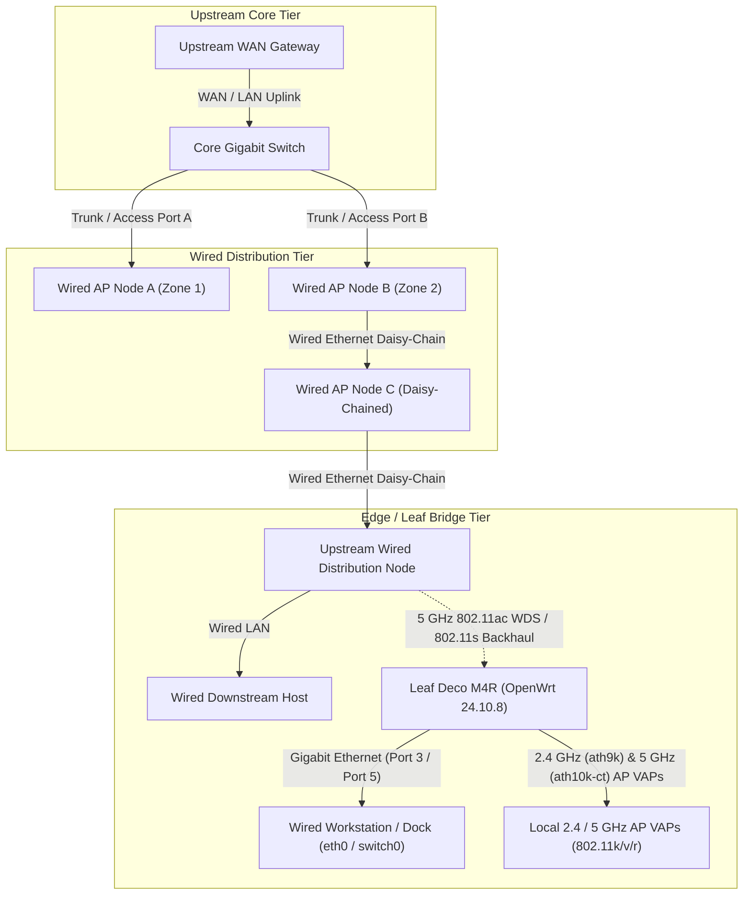

# Clean-Room REA Baseline Firmware Analysis: TP-Link Deco M4R (Stock Linux 3.3.8 vs. OpenWrt 24.10.8 Linux 6.6.144)

## 1. Executive Summary & Clean-Room REA Methodology

This specification documents the clean-room reverse-engineering and architectural (REA) baseline analysis of the stock TP-Link Deco M4R (`v1`/`v2`) firmware images (`1.6.2 Build 20240308 Rel. 66393` and `1.8.0 Build 20250721 Rel. 49216`) in comparison with OpenWrt `24.10.8` (`r29245-f82f46d22d`, Linux `6.6.144`, `ath79/generic`).

All inspection procedures were conducted strictly for hardware/protocol interoperability, bootloader recovery / firmware provisioning verification, and local network administration on user-owned hardware in accordance with EU Directive 2009/24/EC Article 6 and German UrhG § 69d / § 69e. Analysis was restricted to container boundary parsing, kernel module inventories, initialization scripts, ELF header/symbol dependency inspection (`e_machine`, `e_flags`, `DT_NEEDED`), and configuration schema mapping.

### 1.1 Architectural Summary of Findings

1. **Legacy QSDK Kernel & Toolchain Baseline**: Even in the July 2025 stock release (`1.8.0 Build 20250721`), the Deco M4R operates on **Linux 3.3.8** (a 2012 kernel baseline derived from Qualcomm Atheros QSDK `QCA9558.LN` / `premium_beeliner_router`, SDK `5.0.3`), linked against `uClibc-0.9.33.2`, `OpenSSL 1.0.0`, `Lua 5.1.5` (compiled into stripped `LuaQ` bytecode), and legacy `iptables 1.4.21` / `ebtables`.
2. **Volatile RAMFS Configuration & Kernel Key-Derivation Lock**: At boot (`S10boot`), stock firmware mounts a volatile `ramfs` filesystem directly over `/etc/config` and `/etc/profile.d`. Persistent configuration is stored outside standard UCI files in raw SPI-NOR flash partitions (`default-config`, `user-config`, `device-config`, `profile`) managed by `/usr/bin/nvrammanager`. Starting in firmware `1.8.0`, the proprietary kernel module `ktrk.ko` (`S06ktrk_nor`, `S07ktrk`) binds configuration encryption (`libtrk.so` + `/dev/derive_key` `c 229 0`) to the hardware `DEV_ID` via `/sbin/loaduci` and `luci.sys.config`.
3. **Closed Local Management & Cloud Tethering**: Standard interactive SSH on TCP port 22 and local web administration are disabled. `dropbear` (`S49dropbear`) is bound to TCP port `20001` with a custom `TPS-2.0-libtmp` protocol banner and `/etc/dropbear/auth_covert`, rejecting interactive root shells (`Disallow root logins`) and functioning solely as a transport tunnel for `tmpsvr` (`S49tmpsvr`), `libtmpv2.so`, and `/usr/bin/tmp-luci`. All administrative operations require binary TP-Link Management Protocol v2 (TMPv2) opcodes (`0x0001`–`0xc710`, gated by `/etc/profile.d/opcode`) issued either by the vendor mobile application or through persistent TLS tunnels maintained by `cloud-brd` (`S98cloud_brd`) to `*.tplinkcloud.com:443`.
4. **Proprietary Wireless & Switch Abstraction**: The QCA9563 (2.4 GHz) and QCA9886 (5 GHz) radios are driven by 14 out-of-tree QSDK kernel modules (`umac.ko`, `qca_ol.ko`, `qca_da.ko`, `ath_dev.ko`, `ath_hal.ko`) controlled via deprecated Linux Wireless Extensions (`iwpriv`, `iwconfig`, `wlanconfig`) and six proprietary mesh/steering daemons (`awnd`, `apsd`, `repacd`, `wsplcd`, `mcsd`, `nrd`). The QCA8337N 7-port Gigabit switch is driven by `qca-ssdk.ko` + `/usr/sbin/ssdk_sh` and locked by `wandetect3` and `/etc/vlan.d/vlan` into a rigid auto-sensed `eth0.1` (LAN) / `eth0.2` (WAN) bridge topology, preventing user-defined 802.1Q VLAN trunking.
5. **OpenWrt 24.10.8 Transformation**: Replacing the stock firmware with OpenWrt `24.10.8` advances the kernel by 14 years to **Linux 6.6.144 LTS**, replaces `uClibc 0.9.33.2` with `musl 1.2.4`, replaces the fragmented vendor partition table with a unified `15.25 MB` (`0x00060000`–`0x00fa0000`) `firmware` partition using persistent `overlayfs` (`jffs2`), replaces out-of-tree `qcawifi` with mainline `mac80211`/`cfg80211` (`ath9k` + `ath10k-ct`) featuring native Airtime Fairness (ATF) and Airtime Queue Limits (AQL), unlocks full 4096-VID 802.1Q switch VLAN tagging on the QCA8337N, and restores full local root SSH (port 22), `nftables` (`fw4`), `sch_cake` SQM, and telemetry-free operation.

---

## 2. Firmware Container & Flash Layout Decomposition

Clean-room container inspection (`scripts/rea_deco_deconstruct.py` and `docs/openwrt_deco/rea_deco_decomposition_report.json`) establishes the binary structure and bootloader recovery / firmware provisioning seam across stock and OpenWrt images.

### 2.1 Binary Image Comparison Matrix

| Property | Stock Firmware `1.8.0` (`M4R_en_1.8.0_Build_20250721_Rel.49216.bin`) | OpenWrt `24.10.8` Initramfs (`...-initramfs-kernel.bin`) | OpenWrt `24.10.8` Sysupgrade (`...-squashfs-sysupgrade.bin`) |
| :--- | :--- | :--- | :--- |
| **File Size** | `13,280,989` bytes (`12.67 MB`) | `6,806,422` bytes (`6.49 MB`) | `7,143,749` bytes (`6.81 MB`) |
| **SHA-256 Digest** | `b10c15ef6e47c84e9e24f32e12017d5e38b8f5409eda18000aa5d64842735727` | `87dc29352f6d793e2e69cedcad630094eabafbf946318f2a5cbab2cbec820b0f` | `d4d47b91575c58731ce005a7b694780e88ea636ec3f8d03ec948ea49b57b1065` |
| **MD5 Digest** | `4abf12ff974e4f931dfcd4909fad9cc1` | `2042009e1808312516d0c09d6e43a048` | `66a8f15c0ff668e61cb76632372ffda0` |
| **Pre-uImage Vendor Header** | `8,212` bytes (`0x00000000`–`0x00002013`, contains `fw-type:Cloud` metadata & RSA signature block) | `0` bytes (raw `uImage` at `0x00000000` for TFTP RAM boot) | `0` bytes (raw `uImage` at `0x00000000` for `firmware` MTD partition) |
| **uImage Header Offset** | `0x00002014` (`8,212` bytes) | `0x00000000` | `0x00000000` |
| **uImage Magic** | `0x27051956` | `0x27051956` | `0x27051956` |
| **uImage Header CRC32** | `0xFEF33606` | `0xE259C6DC` | `0x63D7C1B9` |
| **uImage Data CRC32** | `0x0D7453DE` | `0xB8AFC195` | `0x35AB0ED4` |
| **uImage Payload Size** | `1,134,136` bytes (`1.08 MB`) | `6,806,358` bytes (`6.49 MB`, includes embedded initramfs cpio) | `2,627,549` bytes (`2.51 MB`) |
| **MIPS Load / Entry Address** | `0x80060000` / `0x80060000` | `0x80060000` / `0x80060000` | `0x80060000` / `0x80060000` |
| **uImage Image Name** | `MIPS OpenWrt Linux-3.3.8` | `MIPS OpenWrt Linux-6.6.144` | `MIPS OpenWrt Linux-6.6.144` |
| **uImage Type / Compression** | `4` (`multi`) / `3` (`lzma`) | `2` (`kernel`) / `3` (`lzma`) | `2` (`kernel`) / `3` (`lzma`) |
| **SquashFS (`hsqs`) Offset** | `0x00122015` (`1,187,861` bytes) | N/A (RAM-resident rootfs inside kernel LZMA stream) | `0x0028181D` (`2,627,613` bytes) |
| **Extracted RootFS Footprint** | `690` files, `90` dirs, `317` symlinks (`1,097` total entries) | RAM-resident recovery environment | `overlayfs` (`rom` SquashFS + writable `jffs2` `/overlay`) |

### 2.2 SPI-NOR 16 MB Partition Layout Transformation

In stock firmware, the 16 MB (`0x01000000`) SPI-NOR flash is fragmented into small fixed vendor partitions managed by `/usr/bin/nvrammanager` (kernel `os-image`, `file-system`, `default-mac`, `pin`, `device-id`, `product-info`, `partition-table`, `soft-version`, `support-list`, `profile`, `default-config`, `user-config`, `device-config`, `group-info`, `tp-data`, and `art`).

OpenWrt `24.10.8` preserves all factory bootloader and RF/identity partitions intact as read-only (`ro`) while consolidating the middle `15,253,504` bytes (`14.55 MB`) into a single dynamic `firmware` partition:

| Flash Offset Range | Size (Bytes) | Stock Partition Role | OpenWrt `24.10.8` DTS Partition | Protection Status |
| :--- | :--- | :--- | :--- | :--- |
| `0x00000000`–`0x0003ffff` | `262,144` (`256 KB`) | U-Boot bootloader (`u-boot`) | `u-boot` (`mtd0`) | Read-only (`ro`) |
| `0x00040000`–`0x0005ffff` | `131,072` (`128 KB`) | U-Boot environment (`u-boot-env`) | `u-boot-env` (`mtd1`) | Read-only (`ro`) |
| `0x00060000`–`0x00fa0000` | `15,253,504` (`14.55 MB`) | Fragmented `os-image`, `file-system`, `profile`, `user-config`, `tp-data` | `firmware` (`mtd2`: auto-split into `kernel`, `rootfs`, `rootfs_data`) | Read-write (`sysupgrade` target) |
| `0x00fa0000`–`0x00feffff` | `327,680` (`320 KB`) | Factory metadata (`default-mac` at `+0x0000`, `pin`, `device-id`, `product-info`) | `info` (`mtd3`, `nvmem-cells` `macaddr_info_0`) | Read-only (`ro`) |
| `0x00ff0000`–`0x00ffffff` | `65,536` (`64 KB`) | Atheros Radio Test (`art`: QCA9563 at `+0x1000`, QCA9886 at `+0x5000`) | `art` (`mtd4`, calibration nvmem cells) | Read-only (`ro`) |

---

## 3. Kernel & Core OS Architecture Comparison

### 3.1 System-Level Architectural Matrix

| Subsystem | Stock Firmware (`1.6.2` & `1.8.0`) | OpenWrt `24.10.8` (`r29245-f82f46d22d`) | Architectural Impact |
| :--- | :--- | :--- | :--- |
| **Distribution Base** | Qualcomm Atheros QSDK (`DISTRIB_ID='QSDK'`, `DISTRIB_RELEASE='QCA9558.LN'`, `DISTRIB_CODENAME='premium_beeliner_router'`) | OpenWrt `24.10.8` (`DISTRIB_TARGET='ath79/generic'`) | Eliminates proprietary QSDK fork and vendor build lock-in (`/home/tplink/data/Group1/520/board/model_qca_qca95xx/sdk/5.0.3/`). |
| **Linux Kernel** | `Linux 3.3.8` (`ar71xx/generic` legacy board files) | `Linux 6.6.144` LTS (`ath79/generic` mainline Device Tree) | 14 years of mainline kernel scheduler, memory management, network stack, and security hardening improvements. |
| **CPU ABI & C Library** | MIPS32r2 MSB O32 (`e_flags=0x70001005`), `uClibc-0.9.33.2` (`/lib/ld-uClibc.so.0`) | MIPS32r2 MSB O32 (`mips_24kc`), `musl 1.2.4` (`/lib/ld-musl-mips-sf.so.1`) | Replaces discontinued `uClibc` with actively maintained, standards-compliant `musl` libc. |
| **Init & Process Supervision** | Legacy OpenWrt `procd` (`2013-07-17`) + 98 SysV-style shell scripts in `/etc/init.d/` | Modern `procd` + `ubus` + `ujail` process sandboxing | Eliminates 50+ proprietary cloud, telemetry, and mesh polling daemons. |
| **Configuration Persistence** | Volatile `ramfs` mounted over `/etc/config` (`S10boot`); XML blobs encrypted via `ktrk.ko` + `libtrk.so` and flashed via `nvrammanager` | Persistent `overlayfs` on `jffs2` (`rootfs_data`) storing standard plaintext `/etc/config/*` UCI files | Restores standard deterministic `/etc/config/` editing, `uci commit`, and `sysupgrade -b` backups. |
| **Scripting Runtime** | `Lua 5.1.5` (`liblua.so.5.1.5`) with precompiled binary bytecode (`LuaQ` header) in `/usr/lib/lua/luci/` | `ucode` (`2025.07.18`) + human-readable configuration scripts | Removes obfuscated precompiled Lua bytecode controllers (`op_manager.lua`, `cloud_dispatcher.lua`). |
| **Cryptography & TLS** | `OpenSSL 1.0.0` (`libcrypto.so.1.0.0`, `libssl.so.1.0.0`), `libssh 4.8.8`, hardcoded 512-bit RSA group key (`/etc/dropbear/pregen_dropbear_rsa_host_key`) | `libmbedtls` / `wolfssl` (TLS 1.3), `dropbear` with Ed25519 / RSA-2048+ host keys | Eliminates end-of-life OpenSSL 1.0.0 and shared 512-bit RSA mesh keys. |
| **Firewall & NAT** | `iptables 1.4.21` (`xtables-multi`, `libxtables.so.10`), `ebtables`, out-of-tree `shortcut-fe.ko` (`S72shortcut-fe`) | `nftables` (`fw4`) + mainline Linux `nf_flow_table` (`flow_offloading` / `flow_offloading_hw`) | Unified IPv4/IPv6/bridge packet filtering with mainline conntrack offload compatible with SQM. |
| **Packet Scheduling & SQM** | Legacy `sch_htb.ko`, `sch_fq_codel.ko`, `sch_sfq.ko` (`S99qos` disables `shortcut-fe` when enabled; no `sch_cake.ko`, no Wi-Fi AQL) | Mainline `sch_cake.ko` + `sch_fq_codel.ko` + `mac80211` Airtime Queue Limits (AQL) & Airtime Fairness (ATF) | Eliminates Wi-Fi and WAN bufferbloat without sacrificing routing stability. |
| **Sysctl Memory & Conntrack Tuning** | `vm.min_free_kbytes=1024` (`S10boot`), `net.nf_conntrack_max=16384` (`/etc/sysctl.conf`), `ip_conntrack_tcp_timeout_established=7440` | Tunable `/etc/sysctl.d/` (`vm.min_free_kbytes=4096`, `net.netfilter.nf_conntrack_max` scaled for AP/router role) | Prevents DMA atomic allocation exhaustion on `ath10k` under heavy multi-client load. |

### 3.2 Complete Inventory of Stock Kernel Modules (`lib/modules/3.3.8/`)

The stock `1.8.0` root filesystem contains **185 kernel modules** (`lib/modules/3.3.8/`), loaded via `/etc/modules-boot.d/`, `/etc/modules.d/`, `/lib/wifi/qca-wifi-modules`, and proprietary init scripts:

| Functional Category | Count | Kernel Modules (`lib/modules/3.3.8/*.ko`) | Architectural Role & Limitations |
| :--- | :--- | :--- | :--- |
| **1. Out-of-Tree QCA Wireless (`lib/wifi/qca-wifi-modules`)** | 14 | `mem_manager.ko` (`12,020 B`), `asf.ko` (`16,320 B`), `qdf.ko` (`38,144 B`), `ath_dfs.ko` (`65,132 B`), `ath_spectral.ko` (`58,504 B`), `umac.ko` (`1,852,068 B`), `ath_hal.ko` (`798,056 B`), `ath_rate_atheros.ko` (`48,376 B`), `hst_tx99.ko` (`16,496 B`), `ath_dev.ko` (`365,428 B`), `qca_da.ko` (`236,416 B` — QCA9563 Direct Attach), `qca_ol.ko` (`1,209,500 B` — QCA9886 Offload), `ath_pktlog.ko` (`47,764 B`), `smart_antenna.ko` (`29,968 B`) | Totaling **4.79 MB** of proprietary kernel code. Exposes `wifi0`/`wifi1` and `ath*` VAPs managed via legacy Wireless Extensions (`iwpriv`, `wlanconfig`). Incompatible with `nl80211`/`mac80211`, AQL, or modern `hostapd`. |
| **2. Switch, VLAN & Hy-Fi Mesh Bridging** | 8 | `qca-ssdk.ko` (`711,364 B` — QCA8337N driver), `hyfi-bridging.ko` (`156,164 B` — QCA Hy-Fi IEEE 1905.1 L2 bridge filter, `/proc/hyfi_filter/*`), `hyfi_iptv.ko`, `bridge.ko`, `stp.ko`, `llc.ko`, `8021q.ko`, `bonding.ko` | `qca-ssdk.ko` requires userland `/usr/sbin/ssdk_sh` ioctls via `/dev/switch_ssdk`; `hyfi-bridging.ko` intercepts L2 forwarding for proprietary `apsd`/`awnd` mesh path selection. |
| **3. Fast-Path Forwarding Offload** | 3 | `shortcut-fe.ko` (`44,028 B`), `shortcut-fe-ipv6.ko` (`44,704 B`), `shortcut-fe-cm.ko` (`34,656 B`) | Out-of-tree Qualcomm Shortcut Forwarding Engine (`/proc/sfe_ipv4/*`). Bypasses Linux Netfilter/QoS stacks; must be unloaded when `S99qos` or `xt_pctl` runs. |
| **4. TP-Link Proprietary Kernel Modules** | 17 | `ktrk.ko` (`/dev/derive_key` `c 229 0` config key derivation), `tp_dhcp_hook.ko` (`/proc/dhcp_hook/dhcp_hook_mac`), `domain_dns.ko`, `domain_tip.ko`, `domain_libs.ko` (`tplinkwifi.net` DNS/HTTP hijack), `neighbor_discover.ko`, `xt_pctl.ko` (parental control DPI/URL blocker), `xt_layer7.ko`, `xt_CHECKPORTS.ko`, `xt_V6PORTS.ko`, `traffic_control.ko` (`/proc/traffic_control/guest`), `statistics.ko` (`/dev/statistics`), `iptv_v2.ko`, `ipv6-pass-through.ko`, `NetUSB.ko`, `GPL_NetUSB.ko`, `kc_Print.ko` | Implements hardware-bound config encryption (`ktrk.ko`), captive DNS interception, DPI parental control (`xt_pctl.ko`), and guest rate limiting (`traffic_control.ko`). |
| **5. Traffic Control (`tc`) Schedulers & Actions** | 26 | Schedulers: `sch_codel.ko`, `sch_fq_codel.ko`, `sch_htb.ko`, `sch_hfsc.ko`, `sch_sfq.ko`, `sch_tbf.ko`, `sch_prio.ko`, `sch_red.ko`, `sch_gred.ko`, `sch_dsmark.ko`, `sch_teql.ko`, `sch_ingress.ko`. Classifiers/Actions: `cls_fw.ko`, `cls_route.ko`, `cls_tcindex.ko`, `cls_u32.ko`, `act_connmark.ko`, `act_gact.ko`, `act_ipt.ko`, `act_mirred.ko`, `act_police.ko`, `act_skbedit.ko`, `em_cmp.ko`, `em_meta.ko`, `em_nbyte.ko`, `em_u32.ko` | Lacks `sch_cake.ko`. Stock `/etc/init.d/qos` (`S99qos`) uses legacy `htb` + `sfq` and only classifies packets marked by `xt_pctl` (`0x8001`–`0x8003`). |
| **6. Netfilter / Xtables / Ebtables (`iptables 1.4.21`)** | 75 | Conntrack/NAT: `nf_conntrack*.ko` (`ftp`, `h323`, `irc`, `netlink`, `pptp`, `proto_gre`, `proto_udplite`, `rtsp`, `sip`, `snmp`, `tftp`), `nf_nat*.ko`, `ipt_MASQUERADE.ko`, `ipt_REDIRECT.ko`, `ipt_NETMAP.ko`. Matches/Targets: `xt_*.ko` (`mark`, `connmark`, `conntrack`, `dscp`, `ecn`, `esp`, `hashlimit`, `helper`, `hl`, `iprange`, `length`, `limit`, `mac`, `multiport`, `owner`, `pkttype`, `policy`, `quota`, `rateest`, `recent`, `sctp`, `socket`, `standard`, `state`, `statistic`, `string`, `tcpmss`, `tcpudp`, `time`, `u32`), `ebtables.ko`, `ebtable_broute.ko`, `ebtable_filter.ko`, `ebtable_nat.ko`, `ebt_*.ko` | Legacy split IPv4/IPv6/bridge table architecture requiring separate `iptables`, `ip6tables`, and `ebtables` rulesets. |
| **7. Tunneling, PPP & VPN Protocols** | 19 | `ppp_generic.ko`, `ppp_async.ko`, `ppp_mppe.ko`, `ppp_synctty.ko`, `pppoe.ko`, `pppox.ko`, `pptp.ko`, `slhc.ko`, `l2tp_core.ko`, `l2tp_netlink.ko`, `l2tp_ppp.ko`, `gre.ko`, `ip_gre.ko`, `sit.ko`, `ipip.ko`, `tunnel4.ko`, `xfrm4_mode_beet.ko`, `xfrm4_mode_transport.ko`, `xfrm4_mode_tunnel.ko` | Supports legacy PPPoE, PPTP, L2TP, and 6rd/DS-Lite (`sit`/`ipip`), but completely lacks `wireguard.ko` or modern IPsec (`strongswan`/`xfrm_interface`). |
| **8. Kernel Cryptography API** | 12 | `aes_generic.ko`, `arc4.ko`, `authenc.ko`, `cbc.ko`, `crypto_blkcipher.ko`, `crypto_hash.ko`, `crypto_wq.ko`, `cryptomgr.ko`, `deflate.ko`, `des_generic.ko`, `ecb.ko`, `hmac.ko`, `md5.ko`, `rng.ko`, `sha1_generic.ko` | Limited to legacy ciphers (`DES`, `RC4`, `MD5`, `SHA1`, software `AES-CBC`) mainly for PPTP (`ppp_mppe`) and L2TP/IPsec. Lacks `chacha20poly1305`, `curve25519`, and `sha256`/`sha512` kernel modules. |
| **9. Filesystems & Block/MTD Layer** | 4 | `fuse.ko`, `ntfs.ko`, `vfat.ko`, `fat.ko` | Leftover USB storage modules (`S40usb` attempts to `insmod usbcore`, `ehci-hcd`, `scsi_mod`, `sd_mod` even though the Deco M4R PCB has no physical USB port populated). |
| **10. Hardware Peripherals, GPIO & Diagnostics** | 7 | `leds-gpio.ko`, `gpio-button-hotplug.ko`, `ar7240_gpio.ko`, `spi_gpio_old.ko`, `i2c-core.ko`, `i2c-algo-bit.ko`, `i2c-gpio.ko` | Legacy `ar71xx` GPIO/LED drivers (`S06ktrk_nor` also creates `/dev/ar7100_flash_chrdev` `c 239 0`). |

### 3.3 Stock Firmware Evolution Diff (`stock_1.6.2` vs. `stock_1.8.0`)

A direct filesystem comparison (`diff -rq stock_1.6.2 stock_1.8.0`) between `1.6.2 Build 20240308 Rel. 66393` and `1.8.0 Build 20250721 Rel. 49216` reveals the exact changes TP-Link introduced on top of the frozen `Linux 3.3.8` kernel:

| Change Type | Components Added / Modified / Removed in `stock_1.8.0` | Technical Function |
| :--- | :--- | :--- |
| **Kernel Modules Added** | `ktrk.ko`, `traffic_control.ko`, `xt_CHECKPORTS.ko`, `xt_V6PORTS.ko` | `ktrk.ko` introduces hardware-bound key derivation (`/dev/derive_key` `c 229 0`) tied to `getfirm DEV_ID`; `traffic_control.ko` adds `/proc/traffic_control/guest` bandwidth limiting; `xt_CHECKPORTS`/`xt_V6PORTS` support MAP-E (`v6plus`) port-set NAT. |
| **Kernel Modules Removed** | `guest_network.ko`, `wan_detect_filter.ko`, `ipv6.ko`, `ip6_tunnel.ko`, `tunnel6.ko` | `guest_network.ko` replaced by `traffic_control.ko` + `ebtables`; `wan_detect_filter.ko` replaced by userland `wandetect3`; IPv6 core/tunnel modules compiled statically into the `3.3.8` kernel image. |
| **Daemons & Init Scripts Added** | `S06ktrk_nor`, `S07ktrk`, `S45wandetect3` (`/usr/bin/wandetect3`), `iot_network` (`/etc/profile.d/opcode-iot`), `guest-bandwidth`, `guest-schedule`, `ddns`, `reboot_schedule` (`/usr/sbin/rsched`), `passthrough.init`, `v6plus` (`/usr/sbin/v6plusd`, `/usr/sbin/mapd`), `client_upload`, `zzzzuhttpd_monit` (`/sbin/uhttpd_monit`) | Replaces `wanDetection` with `wandetect3`; adds isolated IoT SSID VAP profile (`opcode-iot`), guest network bandwidth/schedule enforcement, Japanese ISP `v6plus` (MAP-E), and dedicated station telemetry uploader (`client_upload`). |
| **Shared Libraries Upgraded** | `libcurl.so.4.3.0` -> `libcurl.so.4.7.0`, `libssh.so.4.4.1` -> `libssh.so.4.8.8`, `libpcap.so.1.1.1` -> `libpcap.so.1.9.1`, added `/usr/lib/libtrk.so` | Updates userland curl/libssh/libpcap while leaving `Linux 3.3.8`, `uClibc 0.9.33.2`, and `OpenSSL 1.0.0` unchanged. |
| **Components Removed** | `/etc/ai_roaming`, `/etc/init.d/wanDetection` | Removes unused `/etc/ai_roaming` configuration directory and legacy `wanDetection` service. |

---

## 4. Boot Sequence, Init Scripts & Volatile UCI Configuration Architecture

### 4.1 Ordered Boot Lifecycle (`etc/rc.d/S00*` – `S99*`)

Stock firmware `1.8.0` executes **95 `S*` startup links** and **28 `K*` shutdown links** in `/etc/rc.d/` pointing to `/etc/init.d/`:

```mermaid
flowchart TD
    S00["S00mount_tpdata: Mount /tp_data JFFS2 partition"] --> S05["S05defconfig: Copy /etc/defconfig (leftover wndr3700 file)"]
    S05 --> S06["S06ktrk_nor: mknod /dev/ar7100_flash_chrdev c 239 0"]
    S06 --> S07["S07ktrk: insmod ktrk.ko deviceid=$(getfirm DEV_ID) -> /dev/derive_key c 229 0"]
    S07 --> S10["S10boot: Mount volatile ramfs on /etc/config & /etc/profile.d; run loaduci (nvrammanager + libtrk.so)"]
    S10 --> S14["S14group-key: Load 512-bit RSA pregen_dropbear_rsa_host_key into /etc/config/group-info"]
    S14 --> S15["S15qca-hostapd & S15qca-wpa-supplicant: Start global control sockets"]
    S15 --> S25["S25network: Start netifd & /etc/vlan.d/vlan (ssdk_sh QCA8337N init)"]
    S25 --> S30["S30sysmode & S30tpmodules: Load domain_dns.ko, tp_dhcp_hook.ko, neighbor_discover.ko; start tddp if unbound"]
    S30 --> S41["S41wifi: Create /dev/dk0, /dev/dk1, /dev/caldata; verify ART calibration; spawn ath* VAPs via qcawifi.sh"]
    S41 --> S42["S42awn & S42hyfi-bridging: Start awnd mesh controller & attach br-lan/br-wan to hyfi-bridging.ko"]
    S42 --> S43["S43apsd & S44repacd: Start Adaptive Path Selection (apsd) & QCA RE placement daemon (repacd)"]
    S43 --> S45["S45firewall & S45wandetect3: Load iptables/ebtables rules & start WAN/LAN port auto-sensing"]
    S45 --> S47["S47smartipd & S48conn-indicator & S48dhcp_hook_d: Start Smart IP DHCP & connectivity probes"]
    S47 --> S49["S49dropbear (Port 20001) & S49tmpsvr & S49sync-server: Start TMPv2 management & mesh config sync"]
    S49 --> S50["S50client_mgmt & S50uhttpd: Start station tracking & restricted web status server"]
    S50 --> S52["S52wsplcd & S60cloud_pfclient & S72shortcut-fe & S75mcsd & S77tfstats: IEEE 1905.1, SFE offload, traffic stats"]
    S52 --> S98["S98cloud_brd & S98thermal & S99cloud_* & S99cwmp & S99nrd & S99parental_control & S99qos: Cloud TLS tunnels, TR-069, band steering, DPI"]
```



### 4.2 Volatile RAMFS Overlay & Encrypted NVRAM Persistence Mechanism

A critical architectural finding in `/etc/init.d/boot` (`S10boot`) is how TP-Link prevents persistent local filesystem modification of `/etc/config`:

1. **RAMFS Masking (`/etc/init.d/boot`)**:
   ```sh
   /bin/mount -t ramfs ramfs /etc/config
   /bin/mount -t ramfs ramfs /etc/profile.d
   ```
   Immediately upon running `S10boot`, the read-only SquashFS `/etc/config` and `/etc/profile.d` directories are hidden beneath volatile in-memory `ramfs` mounts.
2. **Hardware-Bound Key Derivation (`S06ktrk_nor` & `S07ktrk`)**:
   - `S06ktrk_nor` creates `/dev/ar7100_flash_chrdev` (`c 239 0`) for raw SPI-NOR partition access.
   - `S07ktrk` reads the hardware device identifier (`devId=$(getfirm DEV_ID)`), loads `/lib/modules/3.3.8/ktrk.ko deviceid=$devId`, and creates `/dev/derive_key` (`c 229 0`).
3. **Encrypted Flash Extraction (`/sbin/loaduci` -> `luci.sys.config`)**:
   - `/sbin/loaduci` invokes precompiled Lua bytecode `/usr/lib/lua/luci/sys/config.lua` (`reload_profile()` and `reloadconfig()`).
   - `luci.sys.config` executes `/usr/bin/nvrammanager -r /tmp/reload-profile.cry -p profile` (and similarly for `default-config`, `user-config`, and `device-config`).
   - It decrypts the partition payloads via `luci.model.crypto` (`crytool` + `/usr/lib/libtrk.so` + `/dev/derive_key`) into XML and parses the XML (`xmlToFile`) into volatile `/etc/config/*` and `/etc/profile.d/*` (`profile`, `interfaces`, `opcode`, `opcode-iot`, `opcode-cfg`).
   - Conversely, `/sbin/saveconfig` serializes volatile `/etc/config/*` back into XML (`fileToXml`), encrypts it via `libtrk.so`, and writes it to SPI-NOR flash via `nvrammanager -w`.
4. **Leftover SDK Artifact (`S05defconfig`)**:
   - `/etc/init.d/defconfig` (`S05defconfig`) attempts to copy `/etc/defconfig/$board/network` if `/etc/config/network` is missing. However, `/etc/defconfig/` in the stock Deco M4R SquashFS contains only `/etc/defconfig/wndr3700/network` (configuring an RTL8366S switch from a Netgear WNDR3700), confirming the uncleaned QSDK legacy tree.

### 4.3 Stock Default UCI Configuration Inspection (`etc/config/`)

Before `S10boot` masks `/etc/config` with `ramfs`, the SquashFS `/etc/config/` directory contains 25 baseline files (`apsd_v2`, `band_steering`, `bind_device_list`, `button`, `cec`, `cloud_config`, `def_ac_ver`, `dhcp`, `dropbear`, `ecm`, `firewall`, `hyfi`, `iptv_v2`, `mcsd`, `network`, `nrd`, `plc`, `qos`, `repacd`, `SmartIP`, `sqm`, `sysmode`, `system`, `uhttpd`, `wireless`, `wsplcd`):

* **`/etc/config/network` & `/etc/vlan.d/vlan`**:
  - Stock `/etc/config/network` defines only `loopback` (`127.0.0.1`) inside SquashFS. During `S10boot` and `S25network`, `/sbin/network_firm` and `/etc/vlan.d/vlan` program the QCA8337N switch via `/usr/sbin/ssdk_sh`:
    - Port `0` (`CPU` MAC0 via RGMII) is configured with `portVlanMemberAdd` to ports `1`, `2`, `3`, `4`, `5` and `fdb PortLearn set <port> disable` (hardware MAC learning is disabled on switch ports so `hyfi-bridging.ko` and `wandetect3` can manage L2 forwarding in software).
    - Physical RJ45 ports on the Deco M4R (`Port 4` and `Port 5` on QCA8337N, mapped via `port_map="1 2 3 4 5"`) are dynamically assigned to `eth0.1` (`br-lan`) or `eth0.2` (`br-wan`) by `/usr/bin/wandetect3` (`S45wandetect3`).
    - Users cannot disable WAN/LAN auto-sensing, cannot assign custom 802.1Q VLAN IDs to individual RJ45 ports, and cannot pass multi-VLAN trunks across the Ethernet ports (the only VLAN option in stock firmware is `iptv_v2`, which bridges a single ISP IPTV VID into `br-iptv`).
* **`/etc/config/sqm` vs. `/etc/config/qos`**:
  - `/etc/config/sqm` is a non-functional placeholder configured for nonexistent interface `eth1` (`option interface 'eth1'`, `option enabled '0'`, `option qdisc 'fq_codel'`, `option script 'simple.qos'`).
  - Actual stock QoS is handled by `/etc/init.d/qos` (`S99qos`) and `/etc/config/qos`, which unloads `shortcut-fe` (`rmmod shortcut_fe_cm`), creates a 3-class `htb` + `sfq` tree on `br-wan` (Download) and `eth0` (Upload), and relies on `xt_pctl` DPI marks (`0x8001` high, `0x8002` middle, `0x8003` low).
* **`/etc/config/repacd`, `/etc/config/wsplcd`, `/etc/config/nrd`, `/etc/config/hyfi`**:
  - Configure Qualcomm Wi-Fi SON / Hy-Fi parameters: `wsplcd` runs IEEE 1905.1 AP Auto-Configuration (`ConfigSta='1'`, `DeepClone='1'`), `repacd` monitors backhaul RSSI thresholds (`RSSIThresholdFar='-75'`, `RSSIThresholdNear='-60'`), and `nrd` (`Network Roaming Daemon`) polls station RSSI to issue proprietary `iwpriv` / netlink band-steering kicks.

---

## 5. Wireless Driver Scripts & Mesh Subsystem Analysis (`lib/wifi/`)

### 5.1 Wireless Script Inventory (`lib/wifi/`)

Stock wireless initialization (`S41wifi` -> `/sbin/wifi`) is implemented across 9 shell scripts in `/lib/wifi/`:

| Script Path | Size (Bytes) | Role in Stock Wireless Stack |
| :--- | :--- | :--- |
| `/lib/wifi/qcawifi.sh` | `71,334` | Core QSDK driver wrapper. Loads the 14 modules listed in `/lib/wifi/qca-wifi-modules`, configures `wifi0` (QCA9563) and `wifi1` (QCA9886) via hundreds of `iwpriv` and `wifitool` calls (`set_hal_param`, `ani_enable`, `burst`, `txchainmask`, `rxchainmask`, `dcs_enable`, `atf_mode`), and spawns `ath*` VAPs via `wlanconfig athX create wlandev wifiY wlanmode ap/sta`. |
| `/lib/wifi/wificommon.sh` | `48,017` | TP-Link Deco wireless orchestration layer. Derives radio/VAP MAC addresses from `/usr/bin/getfirm MAC`, enforces country/regulatory power tables (`/sbin/reload_country.sh`), manages hidden backhaul VAPs, and coordinates `hostapd`/`wpa_supplicant` startup. |
| `/lib/wifi/wifiupdate.sh` | `34,949` | Hot-reload handler invoked by `awnd`/`sync-server` to update SSID, PSK, channel, or guest/IoT VAP state via `iwpriv` and `hostapd_cli` without tearing down all VAPs. |
| `/lib/wifi/hostapd.sh` | `34,741` | Generates per-VAP `/var/run/hostapd-athX.conf` files and attaches them to the global `/var/run/hostapd/global` instance (`S15qca-hostapd`). |
| `/lib/wifi/wpa_supplicant.sh` | `18,225` | Generates `/var/run/wpa_supplicant-athX.conf` for mesh backhaul STA interfaces (`ath02`, `ath12`) attached to `/var/run/wpa_supplicantglobal` (`S15qca-wpa-supplicant`). |
| `/lib/wifi/iface_mgr.sh` | `4,877` | Manages backhaul STA/AP interface state transitions when a satellite node loses connection to the main Deco node. |
| `/lib/wifi/icm.sh` | `4,234` | Configures Qualcomm Intelligent Channel Manager (`icm`) for initial auto-channel selection. |
| `/lib/wifi/wpc.sh` | `1,303` | Configures Qualcomm Wireless Path Calculation (`wpc`) RTT/indoor positioning responder. |
| `/lib/wifi/qca-wifi-modules` | `169` | Ordered list of the 14 out-of-tree kernel modules loaded by `qcawifi.sh`. |

### 5.2 Stock Multi-VAP Interface Matrix (`etc/apsd.json` & `etc/apsd_ap.json`)

To implement isolated Guest, IoT, and Mesh Backhaul networks without DSA or standard `mac80211` VLAN-per-station support, stock firmware spawns up to **16 virtual access point (VAP) interfaces** across the two radios and bridges VLAN sub-interfaces on top of the wireless backhaul links (`etc/apsd.json`):

| Interface Name | Radio (`wifi0`=2.4G, `wifi1`=5G) | Mode | Bridge Assignment | Stock Functional Role |
| :--- | :--- | :--- | :--- | :--- |
| `ath0` / `ath1` | `wifi0` / `wifi1` | AP | `br-lan` | Primary LAN Host SSID (2.4 GHz / 5 GHz). |
| `ath01` / `ath11` | `wifi0` / `wifi1` | AP | `br-lan` (filtered by `ebtables` & `traffic_control.ko`) | Guest Network SSID (2.4 GHz / 5 GHz). |
| `ath05`–`ath08` / `ath15`–`ath18` | `wifi0` / `wifi1` | AP | `br-lan` | Dedicated IoT Network SSID (`iot_network` in `1.8.0`) and auxiliary service VAPs. |
| `ath03` / `ath13` | `wifi0` / `wifi1` | AP (Hidden) | `br-lan` | Hidden Deco Mesh Backhaul AP VAP (`backhaul_ap`), accepting connections from child Deco nodes. |
| `ath02` / `ath12` | `wifi0` / `wifi1` | STA (`wpa_supplicant`) | `br-lan` | Hidden Deco Mesh Backhaul STA VAP (`backhaul_sta`), connecting to parent Deco node. |
| `ath04` / `ath14` | `wifi0` / `wifi1` | AP (Hidden) | `br-lan` | Ephemeral pre-configuration / onboarding backhaul VAP (`config_ap`) used during new Deco node discovery. |
| `ath02.1`, `ath03.1`, `ath12.1`, `ath13.1` | `wifi0` / `wifi1` (`8021q`) | VLAN `.1` on Backhaul | `br-iptv` | Backhaul VLAN trunk carrying IPTV multicast/unicast frames between Deco mesh nodes. |
| `ath02.2`, `ath03.2`, `ath12.2`, `ath13.2` | `wifi0` / `wifi1` (`8021q`) | VLAN `.2` on Backhaul | `br-wan` | Backhaul VLAN trunk carrying WAN frames when the WAN uplink is plugged into a satellite node (`apsd`). |

Because every active AP VAP on a single radio transmits its own beacon frames every `100 ms` at the lowest basic rate (`1 Mbps` on 2.4 GHz, `6 Mbps` on 5 GHz), spawning 4 to 6 simultaneous AP VAPs per radio in stock firmware consumes substantial airtime before any user payload is transmitted.

---

## 6. Proprietary Userland Daemons & Vendor Cloud Lock-In Matrix

All proprietary binaries in `stock_1.8.0` were inspected via clean-room ELF header parsing (`ELF32 MSB`, `e_machine=8` MIPS, `e_flags=0x70001005` MIPS32r2 O32 ABI, dynamic linker `/lib/ld-uClibc.so.0`), `DT_NEEDED` shared library dependency analysis, and string/init-script mapping.

### 6.1 Complete Proprietary Daemon & Binary Matrix

| Binary Path | Size (Bytes) | ELF Entry Point | Linked Shared Libraries (`DT_NEEDED`) | Init Script (`etc/init.d/`) | Kernel / UBus / Network Seams | Hardware & Network Subsystem Locked |
| :--- | :--- | :--- | :--- | :--- | :--- | :--- |
| `/usr/bin/tmpsvr` | `46,356` | `0x00401760` | `libubox.so`, `libpthread.so.0`, `libz.so.1`, `libc.so.0` | `S49tmpsvr` | TCP local socket from `dropbear` (`:20001`), spawns `/usr/bin/tmp-luci` via `libtmpv2.so` | **Local Administration Lock**: Replaces CLI/Web UI with binary TMPv2 opcode dispatcher (`0x0001`–`0xc710`) gated by `/etc/profile.d/opcode`. |
| `/usr/sbin/dropbear` | `155,708` | `0x00402920` | `libuci.so`, `liblua.so.5.1.5`, `libubus.so`, `libubox.so`, `libblobmsg_json.so`, `libcrypt.so.0`, `libutil.so.0`, `libc.so.0` | `S49dropbear` | TCP `:20001`, banner `TPS-2.0-libtmp`, `/etc/dropbear/auth_covert`, `luci.model.accountmgnt` | **SSH Root Shell Lock**: Listens on port `20001` instead of `22`, authenticates against TP-Link Cloud MD5 hashes, and blocks interactive root shell login (`Disallow root logins`). |
| `/usr/bin/cloud-brd` | `135,148` | `0x00402970` | `libpthread.so.0`, `libuci.so`, `libssl.so.1.0.0`, `libcrypto.so.1.0.0`, `liblua.so.5.1.5`, `libubus.so`, `libubox.so`, `libblobmsg_json.so`, `libjson-c.so.2` | `S98cloud_brd` | `/etc/cloud_config.cfg`, TLS `:443` to `n-deventry-gw.tplinkcloud.com` & `n-devs-gw.tplinkcloud.com`, UBus `cloud` | **Cloud Tethering & Remote Control**: Maintains persistent 235s heartbeat TLS tunnel to TP-Link Cloud; dispatches remote cloud RPCs (`cloud_dispatcher.lua`, `passthrough.lua`). |
| `/usr/bin/cloud-client` | `44,904` | `0x00401bc0` | `libpthread.so.0`, `libuci.so`, `liblua.so.5.1.5`, `libubus.so`, `libubox.so`, `libblobmsg_json.so`, `libjson-c.so.2`, `libm.so.0` | `S99cloud_client` | UBus `cloud_client`, `/usr/lib/lua/cloud_TMP.lua` | Bridges cloud RPC events (`connect`, `bind`, `unbind`, `get_token`) into local TMPv2 opcodes. |
| `/usr/bin/cloud-https` | `30,084` | `0x00401760` | `libpthread.so.0`, `libubus.so`, `libubox.so`, `libblobmsg_json.so`, `libjson-c.so.2`, `libcurl.so.4`, `libcrypto.so.1.0.0` | `S99cloud_https` | `/etc/cloud_https.cfg`, `https://n-device-api.tplinkcloud.com:443/v1/validate`, UBus `cloud_https` | Performs device token validation and HTTPS REST calls to TP-Link Cloud APIs. |
| `/usr/bin/cloud-pfclient` | `20,764` | `0x004012f0` | `libubox.so`, `libubus.so`, `libblobmsg_json.so`, `libuci.so`, `libjson-c.so.2`, `libc.so.0` | `S60cloud_pfclient` | UBus `pfclient` | Cloud platform notification and push-forwarding client. |
| `/usr/bin/cloud-proxy` | `14,724` | `0x00400f30` | `libcloud-proxy.so`, `libubox.so`, `libubus.so`, `libblobmsg_json.so`, `libc.so.0` | `S99cloud_proxy` | `/usr/lib/libcloud-proxy.so` | Proxies cloud requests across satellite mesh nodes via the master Deco node. |
| `/usr/bin/nvrammanager` | `51,836` | `0x00401530` | `libc.so.0` | Invoked by `S10boot` (`loaduci`), `saveconfig`, `getfirm` | Raw SPI-NOR flash read/write (`profile`, `default-config`, `user-config`, `device-config`, `art`, `product-info`) | **Proprietary Flash Partition Manager**: Locks configuration and factory data inside custom partition table blocks outside standard MTD `/etc/config`. |
| `/usr/sbin/awnd` | `258,424` | `0x004037b0` | `libuci.so`, `libubox.so`, `libubus.so`, `libblobmsg_json.so`, `libiw.so.29`, `libpthread.so.0`, `libjson-c.so.2`, `libm.so.0` | `S42awn` | UBus `awn`, `/lib/wifi/wifiupdate.sh`, QCA `iwpriv`/netlink | **Auto Wi-Fi Network Daemon**: Proprietary mesh topology controller managing Deco master/slave roles, hidden backhaul links, and channel synchronization. |
| `/usr/bin/apsd` | `141,668` | `0x00402620` | `libpthread.so.0`, `libm.so.0`, `libjson-c.so.2`, `libnl-tiny.so`, `libubus.so`, `libubox.so`, `libblobmsg_json.so`, `libuci.so` | `S43apsd` | `/etc/apsd.json`, `/proc/hyfi_filter/*`, `/proc/sfe_ipv4/*` | **Adaptive Path Selection Daemon**: Controls `hyfi-bridging.ko` forwarding tables across `eth0.1`, `eth0.2`, `ath02`/`ath03`, and `ath12`/`ath13`. |
| `/usr/sbin/nrd` | `204,224` | `0x00402900` | `libhyficommon.so`, `libwpa2.so`, `libieee1905.so`, `libuci.so`, `libubox.so`, `libubus.so`, `libblobmsg_json.so` | `S99nrd` | `/etc/config/nrd`, QCA proprietary `ath_netlink` / `iwpriv` | **Network Roaming Daemon**: Closed-source QCA band-steering and 802.11k/v controller tied exclusively to out-of-tree `umac.ko`. |
| `/usr/sbin/wsplcd` | `143,724` | `0x00402540` | `libhyficommon.so`, `libieee1905.so`, `libwpa2.so`, `libpthread.so.0` | `S52wsplcd` | `/etc/config/wsplcd`, IEEE 1905.1 EtherType `0x893a` | **Wi-Fi Simple Configuration / IEEE 1905.1 Daemon**: Clones Wi-Fi credentials and proprietary QCA SON attributes across mesh nodes. |
| `/usr/sbin/mcsd` | `64,004` | `0x00401800` | `libhyficommon.so`, `libuci.so`, `libc.so.0` | `S75mcsd` | `/etc/config/mcsd`, `hyfi-bridging.ko` | **Multicast Snooping Daemon**: QCA proprietary IGMP/MLD snooping daemon coupled to `hyfi-bridging.ko`. |
| `/usr/bin/client_mgmt` | `66,356` | `0x00401ae0` | `libubox.so`, `libubus.so`, `libblobmsg_json.so`, `libuci.so`, `libjson-c.so.2`, `liblua.so.5.1.5`, `libpthread.so.0` | `S50client_mgmt` | `/tmp/stalist`, `/tmp/client_mgmt_clients`, `client_mgmt_arping`, `client_upload`, `luci.model.app_clientmgmt` | **Station Tracking & Cloud Telemetry**: Continuously polls connected Ethernet/Wi-Fi clients via ARP and `wlanconfig` and uploads association/disassociation events to TP-Link Cloud. |
| `/usr/bin/wandetect3` | `51,836` | `0x00401960` | `libubus.so`, `libubox.so`, `libblobmsg_json.so`, `libuci.so`, `libpthread.so.0`, `libc.so.0` | `S45wandetect3` | `/etc/vlan.d/vlan`, `ssdk_sh`, `br-wan` / `br-lan` | **Auto-Sense WAN/LAN Port Manager**: Dynamically reassigns physical switch ports between `eth0.1` and `eth0.2`, preventing static VLAN port assignment. |
| `/usr/bin/smartipd` | `83,460` | `0x00401940` | `libuci.so`, `libubox.so`, `libubus.so`, `libblobmsg_json.so`, `libc.so.0` | `S47smartipd` | `/etc/config/SmartIP`, `tp_dhcp_hook.ko` (`/proc/dhcp_hook/dhcp_hook_mac`) | **Smart IP / DHCP Controller**: Overrides standard `dnsmasq` IP allocation and manages mesh node IP assignments (`192.168.68.1/22` default pool). |
| `/usr/bin/conn-indicator` | `35,648` | `0x00401480` | `libubox.so`, `libubus.so`, `libblobmsg_json.so`, `libuci.so`, `libc.so.0` | `S48conn-indicator` | DNS/HTTP probes to root servers & vendor endpoints | Continuously probes external DNS/HTTP connectivity and drives LED status state changes (`leds`). |
| `/usr/bin/tfstats` | `19,028` | `0x00401000` | `libubox.so`, `libubus.so`, `libblobmsg_json.so`, `libc.so.0` | `S77tfstats` | `/dev/statistics` (`statistics.ko`), UBus `tfstats` | Collects per-MAC traffic volume counters from kernel `statistics.ko` for mobile app reporting. |
| `/usr/sbin/cwmp` | `204,804` | `0x00402dc0` | `libssl.so.1.0.0`, `libcrypto.so.1.0.0`, `libuci.so`, `libubus.so`, `libubox.so`, `libblobmsg_json.so`, `libjson-c.so.2`, `libxml2.so.2` | `S99cwmp` | TCP `:7547` / UDP `:3478` (STUN), `/etc/cwmp/` (`tr098.xml`, `tr181.xml`), `/usr/bin/tr143d` | **ISP Remote Management (TR-069 / CWMP)**: Exposes WAN-side CPE WAN Management Protocol agent for ISP Auto-Configuration Servers (ACS). |
| `/usr/bin/tddp` | `82,196` | `0x004016b0` | `libpthread.so.0`, `libcrypto.so.1.0.0`, `libc.so.0` | `S30tpmodules` & `S41wifi` | UDP port `1040`, `/usr/sbin/qcmbr_run`, `/usr/sbin/athtestcmd`, `nvrammanager` | **TP-Link Device Debug Protocol**: Runs whenever `/etc/config/bind_device_list` is empty (unconfigured state) or in factory calibration mode; handles factory MAC/PIN/GroupID writing and RF test commands. |
| `/usr/bin/tmpcli` | `30,020` | `0x00401440` | `libtmpv2.so`, `libssh.so.4`, `libuci.so`, `libjson-c.so.2`, `libc.so.0` | Invoked by `sync-server` (`/lib/sync-server/scripts/*`) | SSH `:20001` + `libtmpv2.so` + `/etc/dropbear/pregen_dropbear_rsa_host_key` | **Inter-Node Mesh RPC Client**: Connects to peer Deco nodes on port `20001` using the hardcoded 512-bit RSA key to push encrypted config XML and firmware updates. |
| `/usr/sbin/ssdk_sh` | `664,516` | `0x00400190` | Statically linked (`EABI5` / MIPS O32 static binary) | Invoked by `/etc/vlan.d/vlan` & `wandetect3` | `/dev/switch_ssdk` (`c 238 0`, `qca-ssdk.ko`) | Low-level register/VLAN/FDB CLI utility for the QCA8337N switch. |
| `/usr/sbin/thermald` | `11,764` | `0x00400d50` | `libc.so.0` | `S98thermal` | `/sys/class/net/wifi1/thermal/*` | Monitors QCA9886 5 GHz radio die temperature and throttles duty cycle via QCA sysfs nodes. |

### 6.2 Deep-Dive: How Stock Firmware Locks Out Local Administration

1. **Port 20001 SSH Tunneling & Covert Auth (`dropbear` + `tmpsvr` + `tmp-luci`)**:
   - In `/etc/init.d/dropbear` (`S49dropbear`), `dropbear` is launched on port `20001` (`-p 20001`) instead of port `22`.
   - Binary string inspection of `/usr/sbin/dropbear` shows TP-Link modified the SSH server banner to `TPS-2.0-libtmp`, linked `dropbear` directly against `liblua.so.5.1.5` and `libuci.so`, and hardcoded it to validate credentials via `require("luci.model.accountmgnt").check_tmp_login(username, password)` or `/etc/dropbear/auth_covert`.
   - Interactive shell requests are rejected (`Disallow root logins` / `Premature exit: Terminated by signal`). Instead, authenticated SSH channels are piped to `tmpsvr` (`S49tmpsvr`), which loads `libtmpv2.so` and executes `/usr/bin/tmp-luci`.
   - `/usr/bin/tmp-luci` invokes `luci.sgi.tmp` -> `luci.controller.admin.op_manager`, which checks incoming hex opcodes (`0x0001` through `0xc710`) against `/etc/profile.d/opcode` (`opcode-iot`, `opcode-cfg`) before dispatching them to precompiled Lua bytecode modules in `/usr/lib/lua/luci/controller/admin/mobile_app/*`.
2. **Stripped Local Web Interface (`S50uhttpd` vs. `S99uhttpd-fw`)**:
   - `/etc/init.d/uhttpd` checks `uci get profile.@webui_mgnt[0].routermode_support` and `apmode_support`.
   - Even when active, `/www/webpages/modules/advanced/` contains only basic read-only status views (`networkStatus`, `sysLog`, `sysParams`, `timeSettings`, `wifiPower`, and `firmwareDeco` manual `.bin` upload). Full router/switch/wireless configuration is absent from `/www/` and exists exclusively in the mobile app's TMPv2 opcode handlers.
   - A second instance, `/etc/init.d/uhttpd-fw` (`S99uhttpd-fw`), binds to `127.0.0.1:20003` (`-r /tmp/fw_dir`) solely for internal mesh firmware propagation.
3. **Mandatory Cloud Onboarding & Telemetry (`cloud-brd` + `client_mgmt`)**:
   - Initial setup of the stock Deco M4R requires authenticating with a TP-Link ID via the Deco mobile app, which populates `/etc/config/bind_device_list` and `/etc/config/cloud_config`.
   - While bound, `cloud-brd` (`S98cloud_brd`) maintains a persistent TLS connection to `n-deventry-gw.tplinkcloud.com:443` and `n-devs-gw.tplinkcloud.com:443` (`heartbeat-interval = 235`), while `client_mgmt` and `client_upload` report connected client MAC addresses and association events to TP-Link Cloud (`upload client associate or disassociate message to cloud`).
4. **Hardcoded 512-bit RSA Inter-Node Mesh Key (`S14group-key`)**:
   - `/etc/init.d/group-key` (`S14group-key`) reads `/etc/dropbear/pregen_dropbear_rsa_host_key` (a static **512-bit RSA key** embedded identically in the SquashFS image of every Deco M4R) and injects it into `/etc/config/group-info` (`option key 'AAAAB3NzaC1yc2EAAAADAQABAAAAgQ...'`) for initial inter-node `sync-server` / `tmpcli` communication on port `20001`.

---

## 7. Comprehensive Feature Unlock Matrix: Stock Linux 3.3.8 vs. OpenWrt 24.10.8 (Linux 6.6.144)

The table below maps every hardware and networking capability of the QCA9563 + QCA9886 + QCA8337N platform that was locked, degraded, or missing in stock firmware (`1.8.0`) and is unlocked in OpenWrt `24.10.8` (`Linux 6.6.144`):

| Subsystem / Feature | Stock Firmware (`1.8.0` / Linux `3.3.8` QSDK) | OpenWrt `24.10.8` (Linux `6.6.144` LTS `ath79`) | Technical Unlock Mechanism |
| :--- | :--- | :--- | :--- |
| **1. Local Root SSH & CLI Administration** | **Locked**: Port 22 closed; `dropbear` on `:20001` (`TPS-2.0-libtmp`) blocks interactive shells and only tunnels binary TMPv2 opcodes to `tmpsvr`. | **Unlocked**: Standard `dropbear` SSH server on TCP port `22` with full root shell (`ash`), Ed25519/RSA key auth, and standard `uci` CLI. | Replaces modified TP-Link `dropbear`/`tmpsvr` with mainline OpenWrt `dropbear` and standard Unix authentication. |
| **2. Local Web UI (LuCI)** | **Stripped**: `/www/` limited to read-only status and firmware upload; all configuration locked behind the Deco mobile app and TP-Link Cloud. | **Unlocked**: Full local LuCI web interface (`uhttpd` + `luci-light` / `rpcd` + `ucode`) with 100% local control over interfaces, VLANs, Wi-Fi, and firewall. | Replaces precompiled TMPv2 `op_manager.lua` bytecode with standard local `rpcd` UBus APIs and LuCI views. |
| **3. Persistent Configuration Storage** | **Locked**: `S10boot` mounts volatile `ramfs` over `/etc/config`; configs encrypted via `ktrk.ko` (`libtrk.so` + `/dev/derive_key`) into raw flash partitions. | **Unlocked**: Persistent writable `overlayfs` (`jffs2` on `rootfs_data`) storing human-readable plaintext `/etc/config/*` files across reboots. | Unifies `0x00060000`–`0x00fa0000` (`14.55 MB`) into a standard OpenWrt `firmware` MTD partition with dynamic `rootfs_data`. |
| **4. QCA8337N 802.1Q Switch VLAN Trunking** | **Locked**: `wandetect3` and `/etc/vlan.d/vlan` hardcode auto-sensed `eth0.1` (LAN) / `eth0.2` (WAN) port swapping and disable hardware MAC learning (`PortLearn disable`). | **Unlocked**: Full 7-port Gigabit `swconfig` (`switch0`) supporting up to **4,096 802.1Q VLANs**, per-port tagged/untagged membership, PVIDs, and hardware ARL learning. | Mainline `ar8327`/`qca8k` switch driver exposes `switch0` directly to `netifd` without `wandetect3` or `hyfi-bridging.ko` interference. |
| **5. Multi-SSID to 802.1Q Ethernet VLAN Bridging** | **Locked**: Only supports Main (`br-lan`), Guest (isolated via `ebtables`), and IoT VAPs; cannot map arbitrary SSIDs to custom Ethernet 802.1Q VLAN trunks. | **Unlocked**: Any number of virtual APs (within radio limits) or Dynamic VLANs (`wpa_psk_file` / RADIUS) can bridge directly to tagged `eth0.<VID>` trunks (`br-vlan10`, `br-vlan20`, etc.). | Standard Linux bridge (`br-*` or bridge-vlan filtering) + mainline `mac80211` `nl80211` interface bridging. |
| **6. Wireless Stack & Airtime Fairness (AQL / ATF)** | **Degraded**: Out-of-tree `umac.ko`/`qca_ol.ko`/`qca_da.ko` (`iwpriv`/`wlanconfig`) with massive driver-level FIFO queues and up to 16 beacon-heavy VAPs (`ath0`–`ath18`). | **Unlocked**: Mainline `mac80211`/`cfg80211` (`ath9k` + `ath10k-ct`) with native `fq_codel` per-station queuing, **Airtime Queue Limits (AQL)**, and **Airtime Fairness (ATF)**. | Replaces 4.79 MB of legacy QSDK `.ko` blobs with mainline `mac80211` + Candela Technologies `ath10k-ct` (`v022`htt-mgt firmware). |
| **7. WPA3-SAE & 802.11w Management Frame Protection** | **Missing / Partial**: Stock `hostapd` (`S15qca-hostapd`) defaults to WPA2-PSK (`ccmp`/`tkip`) with `ieee80211w` disabled across `ath*` VAPs. | **Unlocked**: Full **WPA3-SAE**, WPA2/WPA3 mixed mode (`sae-mixed`), OWE (Opportunistic Wireless Encryption), and mandatory/optional **IEEE 802.11w (PMF)**. | Provided by `wpad-basic-mbedtls` / `wpad-mesh-mbedtls` (`hostapd` 2024.09+) over `nl80211`. |
| **8. Standards-Based Fast Roaming (802.11r/k/v) & 802.11s Mesh** | **Vendor-Locked**: Proprietary `awnd`, `apsd`, `wsplcd`, and `nrd` work only with other TP-Link Deco nodes and use closed QCA SON frames. | **Unlocked**: Standard **IEEE 802.11r** Fast BSS Transition (FT-over-DS / FT-over-Air), **802.11k** RRM, **802.11v** BSS Transition Management (`usteer`/`dawn`), and **IEEE 802.11s** mesh across any multi-vendor AP fleet. | Native `hostapd` 802.11r/k/v and `mac80211` 802.11s mesh point (`mesh_id`) support. |
| **9. Smart Queue Management (SQM / CAKE)** | **Missing**: `/etc/config/sqm` is a broken stub (`eth1`); `S99qos` uses legacy `htb`+`sfq` and unloads `shortcut-fe`; `sch_cake.ko` does not exist in `lib/modules/3.3.8/`. | **Unlocked**: Mainline **`sch_cake.ko`** (`luci-app-sqm`) with per-host fairness (`triple-isolate`), `diffserv4`, ACK filtering, and framing overhead compensation. | Native Linux 6.6 `sch_cake` + `ifb` ingress shaping compatible with `nftables` flow offloading. |
| **10. Modern Firewall (`nftables` / `fw4`) & Flow Offloading** | **Legacy**: Split `iptables 1.4.21`, `ip6tables`, and `ebtables` plus out-of-tree `shortcut-fe.ko` (incompatible with QoS and complex netfilter rules). | **Unlocked**: Unified **`nftables` (`fw4`)** with atomic ruleset reloads, IP sets, zone-based forwarding, and mainline Linux `nf_flow_table` software offloading. | Replaces `xtables-multi` and `shortcut-fe.ko` with Linux 6.6 `nf_tables` and `nft_flow_offload`. |
| **11. Modern VPN & Overlay Networking (WireGuard / Tailscale)** | **Missing**: Kernel `3.3.8` has only legacy `pptp.ko`, `l2tp_ppp.ko`, and `ip_gre.ko`; no `wireguard.ko` or modern cryptographic primitives (`chacha20poly1305`). | **Unlocked**: In-kernel **WireGuard (`kmod-wireguard`)**, OpenVPN, IPsec (`strongswan`), ZeroTier, and Babel/OSPF/BGP (`bird2`/`frr`) dynamic routing. | Mainline Linux 6.6 `wireguard` kernel module + `opkg` package ecosystem (`7.9 MB` free flash space on `/overlay`). |
| **12. Zero Cloud Telemetry & ISP Backdoor Removal** | **Locked**: Runs 6 `cloud-*` daemons (`*.tplinkcloud.com:443`), `client_mgmt`/`client_upload` station telemetry, `conn-indicator`, and WAN-side `cwmp` (TR-069 on port `7547`). | **Unlocked**: **Zero vendor cloud daemons**, zero unsolicited outbound connections, zero station MAC telemetry uploads, and zero TR-069 (`cwmp`) listeners. | Complete removal of proprietary userland binaries; local-only network operation by default. |
| **13. Observability & Network Diagnostics** | **Locked**: Only internal `tfstats` (`/dev/statistics`) and cloud logs accessible via mobile app; no SNMP, Prometheus, or `tcpdump` access for the owner. | **Unlocked**: Full local observability via `prometheus-node-exporter-lua`, `collectd`, `ubus call`, `iw dev`, `tcpdump`, syslog streaming, and `ethtool`/switch MIB counters. | Standard Linux 6.6 `/sys/kernel/debug/ieee80211/`, `nl80211`, and OpenWrt telemetry packages. |
| **14. Available Flash & RAM Headroom** | **Constrained**: Stock firmware consumes `12.67 MB` flash and spawns ~35 persistent daemons (`awnd`, `apsd`, `nrd`, `wsplcd`, `mcsd`, `cloud-*`, `cwmp`, `tmpsvr`, `client_mgmt`). | **Unlocked**: Sysupgrade image uses only `6.81 MB`, leaving **`~7.9 MB` writable JFFS2 `/overlay`** and **`~68–75 MB` free RAM** out of `128 MB` DDR2. | Eliminates bloated QSDK modules (`4.79 MB`) and 25+ proprietary userland daemons. |


---

## 8. Reference Multi-Tier Deployment Architecture (Wired Daisy-Chain + Wireless Leaf Bridge)

In mixed wired/wireless topologies where an OpenWrt `24.10.8` Deco M4R leaf node (`Leaf-Bridge-Deco-OpenWrt`) bridges a wired workstation/dock via Gigabit Ethernet (`eth0` / `switch0`) over a 5 GHz wireless backhaul to an upstream wired distribution node (`Upstream-Wired-Deco`), replacing the stock QSDK stack eliminates port-sensing flaps and co-channel beacon bloat.

### 8.1 Reference Logical & Physical Interconnection Graph



| Network Tier | Node / Equipment | Upstream Connection | Downstream / Local Role |
| :--- | :--- | :--- | :--- |
| **Upstream Core** | **WAN Gateway + Core Switch** | ISP Uplink | Distributes wired Gigabit links to distribution APs |
| **Distribution Tier** | **Wired AP Node A** | Core Switch (Port A) | Zone 1 802.11k/v/r wireless coverage |
| **Distribution Tier** | **Wired AP Node B -> Node C** | Core Switch (Port B) | Two-port `switch0` Gigabit pass-through daisy-chain |
| **Edge Distribution** | **Upstream Wired Node** | Wired daisy-chain from Node C | Serves local wired host + 5 GHz wireless backhaul peer |
| **Leaf Bridge** | **Leaf Deco M4R (`OpenWrt 24.10.8`)** | 5 GHz wireless link (`WDS` / `802.11s`) | Deterministic `br-lan` Gigabit Ethernet bridge to workstation dock + local AP |

### 8.2 Architectural Comparison: Stock QSDK vs. OpenWrt `24.10.8` for Wired-Client Wireless Bridging

1. **Deterministic Gigabit Switch Bridge (`switch0` -> Docked Workstation)**:
   - **Physical Connection**: `Leaf-Bridge-Deco-OpenWrt` connects via its `QCA8337N` Gigabit Ethernet ports (`eth0.1` / `br-lan`) to a downstream Ethernet client or dock while simultaneously serving 2.4 GHz and 5 GHz Wi-Fi AP VAPs.
   - **Stock Firmware Limitation**: When a stock Deco M4R acts as a wireless satellite bridging a wired client on its RJ45 ports (`hyfi-bridging.ko` + `apsd` + `wandetect3`), `wandetect3` periodically re-evaluates port states on link transitions (such as a dock sleeping or waking), which can momentarily flap `br-lan` vs. `br-wan` auto-sensing. Furthermore, stock firmware routes traffic through proprietary `hyfi-bridging` L2 translation tables with hardware switch ARL learning disabled (`fdb PortLearn set disable`).
   - **OpenWrt `24.10.8` Advantage**: Disables `wandetect3` completely and locks both external RJ45 ports (`Port 3` and `Port 5` on `switch0`) deterministically into `br-lan` (or tagged/untagged 802.1Q VLANs) with hardware ARL MAC learning enabled (`PortLearn` active) and `mac80211` WDS (`4addr` mode) or `802.11s` transparent L2 bridging, ensuring instant link recovery on carrier wake.
2. **Close-Range Co-Channel RF Coexistence**:
   - Where an upstream wired AP and a wireless leaf bridge operate in close proximity, stock firmware locks all nodes onto identical 2.4 GHz and 5 GHz channels at fixed high TX power with up to 16 hidden VAP beacons, causing co-channel contention and receiver saturation.
   - Under OpenWrt `24.10.8`, each node independently selects non-overlapping channels, tunes per-radio `txpower`, limits active VAPs, and enforces `ath10k-ct` / `ath9k` Airtime Queue Limits (`aql_txq_limit = 1500–2000 µs`).
