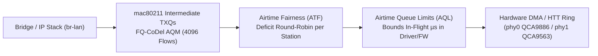

# TP-Link Deco M4R v1 — RF & Wireless Hardware Capability Unlock Guide (OpenWrt 24.10.8)

## 1. Executive Summary & Radio Architecture

Replacing the stock TP-Link firmware (`Linux 3.3.8` with proprietary QCA SDK wireless drivers) with **OpenWrt 24.10.8 (`Linux 6.6.144`, `mac80211` backports `6.12.96-r1`)** transitions both radios on the TP-Link Deco M4R v1 to the modern Linux wireless stack (`cfg80211` / `mac80211`, `ath10k-ct`, `ath9k`, and `hostapd v2.12-devel`).

### Hardware & Driver Inventory (Live Interrogation)

| Attribute | 5 GHz Radio (`phy0` / `radio0`) | 2.4 GHz Radio (`phy1` / `radio1`) |
| :--- | :--- | :--- |
| **Silicon Controller** | Qualcomm Atheros QCA9886 (`qca9888 hw2.0`, Target `0x01000000`) | Qualcomm Atheros QCA9563 SoC WMAC (`AR9561 Rev:0`, `macVersion 0x600`) |
| **System Bus & Path** | PCIe Gen 2 x1 (`0000:00:00.0`, PCI ID `168c:0056`, Legacy IRQ) | AHB Internal Bus (`platform/ahb/18100000.wmac`, IRQ 2) |
| **IEEE Standard** | IEEE 802.11a/n/ac Wave-2 | IEEE 802.11b/g/n |
| **MIMO & Spatial Streams** | 2T2R (`2x2:2`), TX/RX Chainmask `0x3` | 2T2R (`2x2:2`), TX/RX Chainmask `0x3` |
| **Max Channel Width & PHY Rate** | `VHT80` (80 MHz) — **866.7 Mbps** (MCS 9, 2SS, SGI) | `HT40` (40 MHz) — **300.0 Mbps** / `HT20` — **144.4 Mbps** (MCS 15) |
| **Kernel Driver Module** | `kmod-ath10k-ct` (`6.6.144.2024.07.30~ac71b14d-r2`) | `kmod-ath9k` + `kmod-ath9k-common` (`6.6.144.6.12.96-r1`) |
| **Radio Firmware / Calibration** | `ath10k-firmware-qca9888-ct` (`10.4b-ct-9888-fW-13-5ae337bb1`), `pre-cal-nvmem` + `board-2.bin` (`bmi_id 0:24`) | Driver-native register HAL (`ath9k_hw`), SPI NOR `art` EEPROM (`0x1000`) |
| **Rate Control Algorithm** | Target Firmware + Driver (`hw/driver`, `tx-rc-CT` / `ratemask-CT`) | Kernel `mac80211` `minstrel_ht` (`SUPPORTS_RC_TABLE`) |
| **Intermediate Queueing (AQM)** | `mac80211` `TXQS` (FQ-CoDel, 4096 flows, 16 MB limit) + **AQL** + **ATF** | `mac80211` `TXQS` (FQ-CoDel, 4096 flows, 4 MB limit) + **AQL** + **ATF** |

### Installed Wireless Stack (`opkg list-installed`)

```text
ath10k-board-qca9888 - 20241110-r2
ath10k-firmware-qca9888-ct - 2020.11.08-r1
hostapd-common - 2024.09.15~5ace39b0-r3
iw - 6.9-r1
iwinfo - 2024.10.20~b94f066e-r1
kmod-ath - 6.6.144.6.12.96-r1
kmod-ath10k-ct - 6.6.144.2024.07.30~ac71b14d-r2
kmod-ath9k - 6.6.144.6.12.96-r1
kmod-ath9k-common - 6.6.144.6.12.96-r1
libiwinfo-data - 2024.10.20~b94f066e-r1
libiwinfo20230701 - 2024.10.20~b94f066e-r1
rpcd-mod-iwinfo - 2025.09.01~bba95191-r2
ucode-mod-math - 2025.07.18~3f64c808-r1
wpad-basic-mbedtls - 2024.09.15~5ace39b0-r3
```

---

## 2. 5 GHz Radio (`phy0`, QCA9886 PCIe `168c:0056`)

### 2.1 Silicon Probing, Calibration & PCIe Bus Attachment

On the Deco M4R v1, the 5 GHz radio is a discrete Qualcomm Atheros **QCA9886** PCIe transceiver attached to bus `0000:00:00.0` (`vendor=0x168c`, `device=0x0056`, `subsystem_vendor=0x0000`, `subsystem_device=0x0000`). Within the `ath10k` driver architecture, the QCA9886 shares the `qca9888 hw2.0` silicon family (`target 0x01000000`, `chip_id 0x00000000`):

```text
[   19.704651] ath10k 6.10 driver, optimized for CT firmware, probing pci device: 0x56.
[   19.772372] ath10k_pci 0000:00:00.0: enabling device (0000 -> 0002)
[   19.779156] ath10k_pci 0000:00:00.0: pci irq legacy oper_irq_mode 1 irq_mode 0 reset_mode 0
[   23.267337] ath10k_pci 0000:00:00.0: qca9888 hw2.0 target 0x01000000 chip_id 0x00000000 sub 0000:0000
[   23.276938] ath10k_pci 0000:00:00.0: kconfig debug 0 debugfs 1 tracing 0 dfs 1 testmode 0
[   23.650107] ath10k_pci 0000:00:00.0: board_file api 2 bmi_id 0:24 crc32 5968d47d
[   25.742449] ath10k_pci 0000:00:00.0: htt-ver 2.2 wmi-op 6 htt-op 4 cal pre-cal-nvmem max-sta 32 raw 0 hwcrypto 1
```

Key hardware initialization properties verified via `/sys/kernel/debug/ieee80211/phy0/ath10k/firmware_info` and `fw_checksums`:
- **Pre-Calibration Data (`pre-cal-nvmem`)**: Per-unit RF factory calibration is extracted directly from the SPI NOR `art` partition (`mtd4` at offset `0x5000`) via the Linux NVMEM subsystem and merged with the generic board reference file `ath10k/QCA9888/hw2.0/board-2.bin` (`bmi_id 0:24`, CRC32 `5968d47d`, active board CRC32 `9ec997a9`).
- **Firmware Binary Checksums**: `firmware-5.bin` (`59e741e7`), `athwlan` (`e8990230`), `otp` (`dfa21fe6`), `codeswap` (`ebbdf09f`).

### 2.2 Wave-2 802.11ac 2x2:2, SU/MU-MIMO Beamforming & VHT80 Capabilities

`iw phy phy0 info` exposes both High Throughput (`HT`, 802.11n in 5 GHz) and Very High Throughput (`VHT`, 802.11ac Wave-2) capability bitmasks:

- **Antenna Configuration**: `Available Antennas: TX 0x3 RX 0x3`, `Configured Antennas: TX 0x3 RX 0x3` (2 transmit chains, 2 receive chains, 2 spatial streams).
- **HT Capabilities (`0x19ef`)**:
  - `RX LDPC` (Low-Density Parity-Check hardware decoding)
  - `HT20/HT40` with `RX HT20 SGI` and `RX HT40 SGI`
  - `TX STBC` and `RX STBC 1-stream` (Space-Time Block Coding)
  - `Max AMSDU length: 7935 bytes`
  - `Maximum RX AMPDU length: 65535 bytes (exponent: 0x003)`, `Minimum RX AMPDU time spacing: 8 usec (0x06)`
  - `HT TX/RX MCS rate indexes supported: 0-15`
- **VHT Wave-2 Capabilities (`0x339979b2`)**:
  - **Max MPDU Length**: `11454 bytes` (maximum 802.11ac frame size before A-MPDU aggregation)
  - **Channel Bonding**: `VHT20`, `VHT40`, and `VHT80` (`short GI (80 MHz)` supported; `VHT160` and `80+80` are not supported on 2x2 QCA9886 silicon)
  - **VHT MCS Set**: 1 stream `MCS 0-9`, 2 streams `MCS 0-9` (TX and RX)
  - **Wave-2 Beamforming Engine**:
    - `SU Beamformer` (Single-User transmit beamforming with 2 sounding dimensions: `[SOUNDING-DIMENSION-2]`)
    - `SU Beamformee` (Single-User receive beamforming up to 2 beamformer antennas: `[BF-ANTENNA-2]`)
    - `MU Beamformer` (Wave-2 Downlink Multi-User MIMO transmit beamforming)
    - `MU Beamformee` (Wave-2 Downlink Multi-User MIMO client reception)
  - **Additional VHT Features**: `RX LDPC`, `TX STBC`, `RX antenna pattern consistency`, `TX antenna pattern consistency`, `VHT-TXOP-PS`, `HTC-VHT`, `MAX-A-MPDU-LEN-EXP7` (up to 1,048,575-byte A-MPDU aggregates; HTT configured via `/sys/kernel/debug/ieee80211/phy0/ath10k/htt_max_amsdu_ampdu` as `3` A-MSDUs / `64` MPDUs per A-MPDU).

When `htmode 'VHT80'` is enabled in `/etc/config/wireless`, `/lib/netifd/wireless/mac80211.sh` parses `0x339979b2` and populates `hostapd` with:

```ini
ieee80211ac=1
vht_oper_chwidth=1
vht_capab=[RXLDPC][SHORT-GI-80][TX-STBC-2BY1][SU-BEAMFORMER][SU-BEAMFORMEE][MU-BEAMFORMER][MU-BEAMFORMEE][VHT-TXOP-PS][HTC-VHT][RX-ANTENNA-PATTERN][TX-ANTENNA-PATTERN][RX-STBC-1][SOUNDING-DIMENSION-2][BF-ANTENNA-2][MAX-MPDU-11454][MAX-A-MPDU-LEN-EXP7]
```

### 2.3 5 GHz Spectrum Allocation & DFS Radar Detection (`UNII-1` to `UNII-3`)

Under `country US: DFS-FCC` (`iw reg get` and `iw phy phy0 info`), all 27 standard 5 GHz channels across UNII-1, UNII-2a, UNII-2c, and UNII-3 are unlocked, including full hardware DFS radar pulse detection (`kconfig ... dfs 1`):

| Band | Channels | Frequency Range (MHz) | Max TX Power | Regulatory / DFS Flags | Available `VHT80` Blocks |
| :--- | :--- | :--- | :--- | :--- | :--- |
| **UNII-1** | `36, 40, 44, 48` | `5180 – 5240` | `23.0 dBm` (200 mW) | `AUTO-BW` (No DFS required) | Ch `36–48` (Center `42`) |
| **UNII-2a (DFS)** | `52, 56, 60, 64` | `5260 – 5320` | `24.0 dBm` (251 mW) | `DFS`, `AUTO-BW`, `radar detection` | Ch `52–64` (Center `58`) |
| **UNII-2c (DFS)** | `100, 104, 108, 112, 116, 120, 124, 128, 132, 136, 140, 144` | `5500 – 5720` | `24.0 dBm` (251 mW) | `DFS`, `radar detection` (up to 160 MHz reg rule) | Ch `100–112` (Center `106`), Ch `116–128` (Center `122`), Ch `132–144` (Center `138`) |
| **UNII-3** | `149, 153, 157, 161, 165` | `5745 – 5825` | `30.0 dBm` (1000 mW) | `AUTO-BW` (No DFS required) | Ch `149–161` (Center `155`) |
| **UNII-3/4 Ext** | `169, 173` | `5845 – 5865` | `27.0 dBm` (501 mW) | `NO-OUTDOOR`, `AUTO-BW`, `PASSIVE-SCAN` (`no IR`) | `HT40` / `VHT40` only |

#### Hardware DFS Pulse Detector Telemetry
The QCA9886 baseband reports radar PHY errors (`WMI_SERVICE_PHYERR enabled`) to the `ath10k` pattern detector (`radar detect widths: { 20 MHz (no HT), 20 MHz, 40 MHz, 80 MHz, 80+80 MHz, 160 MHz }`). Real-time radar statistics and test hooks are exposed in `/sys/kernel/debug/ieee80211/phy0/ath10k/`:
- `dfs_stats`: Tracks `reported phy errors`, `pulse events reported`, `DFS pulses detected`, `DFS pulses discarded`, `Radars detected`, and `Last-DFS-Msg`.
- `dfs_simulate_radar`: Write-only trigger (`echo 1 > dfs_simulate_radar`) to test Channel Switch Announcement (`CSA`) and Channel Availability Check (`CAC`) failover without external RF test gear.
- `dfs_block_radar_events`: Diagnostic toggle for radar event processing.

### 2.4 Valid Interface Combinations (Simultaneous AP + 802.11s Mesh + STA/WDS)

`iw phy phy0 info` reports the following multi-interface concurrency matrix:

```text
Supported interface modes:
     * IBSS
     * managed
     * AP
     * AP/VLAN
     * monitor
     * mesh point
     * P2P-client
     * P2P-GO
     * P2P-device
valid interface combinations:
     * #{ managed } <= 16, #{ AP, mesh point } <= 16, #{ IBSS } <= 1,
       total <= 16, #channels <= 1, STA/AP BI must match,
       radar detect widths: { 20 MHz (no HT), 20 MHz, 40 MHz, 80 MHz, 80+80 MHz, 160 MHz }
Maximum associated stations in AP mode: 32
```

This unlocks single-radio multi-role concurrency on the 5 GHz band (`#channels <= 1`, matching beacon intervals):
- Up to **16 simultaneous virtual interfaces (`vdevs: 16`)** mixing `AP` (multiple VLAN-tagged SSIDs), `mesh point` (IEEE 802.11s mesh backhaul), and `managed` (`STA` client / 4-address `WDS` bridge) modes concurrently on the same 5 GHz channel.
- Up to **32 associated stations (`max-sta 32`)** and **48 total WMI peers (`peers: 48`, `tid: 96`)** in hardware SRAM/IRAM.

### 2.5 `ath10k-ct` vs. Mainline Qualcomm `ath10k` Firmware Analysis

OpenWrt 24.10.8 defaults to **Candela Technologies (`ath10k-ct`)** driver and firmware (`10.4b-ct-9888-fW-13-5ae337bb1`, API 5) rather than mainline Qualcomm `ath10k`.

#### Firmware Resource & Memory Footprint (`dmesg`)
```text
ath10k_pci 0000:00:00.0: 10.4 wmi init: vdevs: 16  peers: 48  tid: 96
ath10k_pci 0000:00:00.0: msdu-desc: 2500  skid: 32
ath10k_pci 0000:00:00.0: wmi print 'P 48/48 V 16 K 144 PH 176 T 186  msdu-desc: 2500  sw-crypt: 0 ct-sta: 0'
ath10k_pci 0000:00:00.0: wmi print 'free: 114572 iram: 12644 sram: 29508'
```
- **Target Memory Headroom**: `114,572 bytes` total free (`12,644 bytes` IRAM, `29,508 bytes` SRAM), supporting `2,500` MSDU descriptors (`msdu-desc: 2500`), `144` hardware crypto keys (`K 144`), and `186` TID queues (`T 186`).

#### Unlocked `ath10k-ct` Feature Flags (`/sys/kernel/debug/ieee80211/phy0/ath10k/firmware_info`)

| Feature Flag | Engineering Capability Unlocked by `ath10k-ct` |
| :--- | :--- |
| `mfp` | Native IEEE 802.11w Management Frame Protection (BIP-CMAC-128) in target firmware. |
| `peer-flow-ctrl` | Per-peer HTT TX queue flow control, enabling host-side `mac80211` FQ-CoDel (`TXQS`) and AQL. |
| `txstatus-noack` | Reports explicit per-frame TX no-ACK failures to `mac80211` (`REPORTS_TX_ACK_STATUS`). |
| `wmi-10.x-CT` | Extended Candela WMI command protocol over standard 10.4 WMI API (`wmi-op 6`, `htt-op 4`). |
| `ratemask-CT` / `txrate-CT` / `txrate2-CT` | Fine-grained MCS/NSS rate mask overrides (`set_rates`, `set_rate_override`) and accurate TX rate telemetry. |
| `tx-rc-CT` | Enhanced target rate control with host overrides (such as `rc-txbf-probe` and custom PER thresholds). |
| `flush-all-CT` / `wmi-block-ack-CT` | Deterministic queue flushing and Block-ACK window management during fast roaming or channel switches. |
| `regdump-CT` / `ch-regs-CT` | Full hardware register dump and channel register inspection (`fw_regs`, `reg_addr`, `reg_value`) without crashing the target. |
| `set-special-CT` | Live runtime tuning via `/sys/kernel/debug/ieee80211/phy0/ath10k/ct_special` (CCA thresholds, TX power latch, SU/MU sounding timers, station kickout thresholds). |
| `cust-stats-CT` | Extended per-peer and per-pdev hardware telemetry (`peer_stats`, `pdev_ext_stats`, `tpc_stats`). |
| `beacon-cb-CT` / `wmi-bcn-rc-CT` | Host beacon callback synchronization and custom beacon rate control. |

#### Enabled WMI Services (`/sys/kernel/debug/ieee80211/phy0/ath10k/wmi_services`)
Among the 120+ WMI service slots, the QCA9886 CT firmware actively enables:
- **802.11ac & Offloads**: `WMI_SERVICE_11AC`, `WMI_SERVICE_BLOCKACK`, `WMI_SERVICE_TX_ENCAP`, `WMI_SERVICE_BCN_MISS_OFFLOAD`, `WMI_SERVICE_RATECTRL_CACHE`
- **Mesh & Bridge Support**: `WMI_SERVICE_MESH_11S`, `WMI_SERVICE_MESH_NON_11S`, `WMI_SERVICE_ENHANCED_PROXY_STA`, `WMI_SERVICE_VDEV_RX_FILTER`
- **Scheduling & Airtime**: `WMI_SERVICE_ATF` (Airtime Fairness), `WMI_SERVICE_TX_MODE_PUSH_ONLY`, `WMI_SERVICE_TX_MODE_PUSH_PULL`, `WMI_SERVICE_TX_MODE_DYNAMIC`
- **Power & Thermal Management**: `WMI_SERVICE_STA_PWRSAVE`, `WMI_SERVICE_STA_ADVANCED_PWRSAVE`, `WMI_SERVICE_AP_UAPSD`, `WMI_SERVICE_AP_PS_DETECT_OUT_OF_SYNC`, `WMI_SERVICE_THERM_THROT`, `WMI_SERVICE_TT`
- **Diagnostics, Crypto & Ranging**: `WMI_SERVICE_PHYERR`, `WMI_SERVICE_RTT` (802.11mc Round-Trip Time ranging), `WMI_SERVICE_PEER_STATS`, `WMI_SERVICE_PERIODIC_CHAN_STAT_SUPPORT`, `WMI_SERVICE_BSS_CHANNEL_INFO_64`, `WMI_SERVICE_PER_PACKET_SW_ENCRYPT`, `WMI_SERVICE_SMART_ANTENNA_SW_SUPPORT`

#### Runtime `ct_special` Register Tuning (`/sys/kernel/debug/ieee80211/phy0/ath10k/ct_special`)
`ath10k-ct` exposes a 64-bit `(id << 32) | val` interface at `ct_special` for low-level RF parameters unavailable in mainline `ath10k`:
- `id = 0x3`: `THRESH62_EXT` (Clear Channel Assessment energy detection threshold adjustment)
- `id = 0x4`: `CCA-Values` (`minCcaPwr`, `noiseFloorThresh`, `enable_minccapwr_thresh`)
- `id = 0x6`: `Max TX-Power` latch in 0.5 dBm steps
- `id = 0x7`: `RC max PER Threshold` (0–256, default `50`)
- `id = 0x1001`: `sta-kickout threshold` due to consecutive TX failures (default `320`, `0` disables)
- `id = 0x1002`: `su-sounding-timer-ms` (SU-MIMO beamformer sounding interval, default `100` ms, max `500` ms)
- `id = 0x1003`: `mu-sounding-timer-ms` (MU-MIMO beamformer sounding interval, default `40` ms)
- `id = 0x1004`: `rc-txbf-probe` (`1` enables active TXBF rate-control probing)

> [!NOTE]
> **When to Switch Between `ath10k-ct` and Mainline `ath10k`**: `kmod-ath10k-ct` + `ath10k-firmware-qca9888-ct` provides superior `ct_special` observability, explicit no-ACK feedback, and custom rate-control hooks for AP deployments. If raw IEEE 802.11 frame injection or specific encrypted 802.11s mesh + AP + WDS combinations trigger firmware assertions in CT's custom rate-control path, replacing `kmod-ath10k-ct` / `ath10k-firmware-qca9888-ct` with mainline `kmod-ath10k` / `ath10k-firmware-qca9888` uses Qualcomm's reference WMI rate control while retaining `mac80211` `TXQS` and AQL.

---

## 3. 2.4 GHz Radio (`phy1`, QCA9563 WMAC / `ath9k`)

### 3.1 AHB WMAC Architecture & 802.11n 2x2:2 Capabilities

The 2.4 GHz radio (`phy1`) is integrated directly into the **Qualcomm Atheros QCA9563 SoC** on the internal AHB bus (`platform/ahb/18100000.wmac`, `Atheros AR9561 Rev:0`, `irq=2`, `macVersion = 0x600`, `macRev = 0x0`) and driven by the open-source, firmware-free `ath9k` kernel driver:

- **Antenna Configuration**: `Available Antennas: TX 0x3 RX 0x3`, `Configured Antennas: TX 0x3 RX 0x3` (`tx_chainmask = 3`, `rx_chainmask = 3`).
- **HT Capabilities (`0x11ee`)**:
  - `HT20/HT40` channel bonding (`20 MHz` and `40 MHz`)
  - `RX HT20 SGI` and `RX HT40 SGI` (400 ns Short Guard Interval)
  - `TX STBC` and `RX STBC 1-stream`
  - `Max AMSDU length: 3839 bytes`
  - `DSSS/CCK HT40`
  - `Maximum RX AMPDU length: 65535 bytes (exponent: 0x003)`, `Minimum RX AMPDU time spacing: 8 usec (0x06)`
  - `HT TX/RX MCS rate indexes supported: 0-15` (2 spatial streams, up to **144.4 Mbps** in `HT20` or **300.0 Mbps** in `HT40`)
- **2.4 GHz Channel & Power Table (`country US: DFS-FCC`)**:
  - Channels `1` through `11` (`2412.0 MHz` – `2462.0 MHz`): Max regulatory/hardware limit **`26.0 dBm` (398 mW)** per `iw phy phy1 info` (Channels `12–14` disabled under `US` regulatory rules; `12–13` unlock automatically when `country` is set to ETSI/EU domains).
- **Valid Interface Combinations**:
  ```text
  #{ managed } <= 2048, #{ AP, mesh point } <= 8, #{ P2P-client, P2P-GO } <= 1, #{ IBSS } <= 1,
  total <= 2048, #channels <= 1, STA/AP BI must match
  ```
  Supports up to **8 concurrent AP / 802.11s Mesh Point interfaces** plus `managed` (STA/WDS), `monitor`, `AP/VLAN`, `IBSS`, `P2P-client`, `P2P-GO`, and `outside context of a BSS` (802.11p OCB).

### 3.2 Hardware Encryption Engines (`phy1` & `phy0`)

Both radios implement dedicated silicon cryptographic accelerators for IEEE 802.11 frame protection, offloading the 775 MHz MIPS 74Kc CPU from per-packet cipher operations:

1. **QCA9563 WMAC Hardware Keycache (`phy1`, `ath9k`)**:
   - Hardware crypto initialized via `ath9k_cmn_init_crypto` (`RXKCM` RX Key Cache Miss interrupt tracking in `/sys/kernel/debug/ieee80211/phy1/ath9k/interrupt`).
   - Accelerates **AES-CCMP-128** (WPA2/WPA3 data frames), **AES-CMAC-128 / BIP** (`MFP_CAPABLE` in `phy1/hwflags` for 802.11w Protected Management Frames), **TKIP**, and legacy **WEP-40/104** in hardware DMA.
   - Advertises `[ CAN_REPLACE_PTK0 ]` (`can safely replace PTK 0 when rekeying`), eliminating packet drops or replay counter races during periodic WPA2/WPA3 Pairwise Transient Key (PTK) rekeying.
   - Can be switched to software `mac80211` crypto via module parameter `nohwcrypt=1` if exotic software-only ciphers (e.g., GCMP-256) are required.
2. **QCA9886 Target Crypto Engine (`phy0`, `ath10k-ct`)**:
   - Operates with `hwcrypto 1` (`sw-crypt: 0`) and `144` hardware key slots (`K 144`).
   - Advertises `MFP_CAPABLE`, `SW_CRYPTO_CONTROL`, `SUPPORTS_PER_STA_GTK`, and `WMI_SERVICE_PER_PACKET_SW_ENCRYPT` (`enabled`), allowing seamless hardware AES-CCMP-128 acceleration alongside per-packet software encryption fallback when required by specific virtual interface modes.

### 3.3 Low-Level `debugfs` Telemetry & Baseband Calibration (`/sys/kernel/debug/ieee80211/phy1/ath9k/`)

Unlike closed-source vendor drivers, `ath9k` exposes its entire baseband register state, EEPROM calibration tables, and hardware DMA queues under `/sys/kernel/debug/ieee80211/phy1/ath9k/`:

- **Base & Modal EEPROM Calibration (`base_eeprom` & `modal_eeprom`)**:
  - `EEPROM Version: 2`, `Device Type: 4`, `TX Mask: 3`, `RX Mask: 3`, `Allow 2GHz: 1`, `Enable Tx Temp Comp: 1`, `Enable fast clock: 1`, `Enable doubling: 1`, `Internal regulator: 1`, `Tx Gain: 2`, `WLAN LED Gpio: 8`, `MacAddress: XX:XX:XX:XX:XX:XX`.
  - `2GHz modal Header`: `Chain0/1 Ant. Control: 16`, `Chain0/1 xatten1DB: 27`, `Chain0/1 xatten1Margin: 11`, `Temp Slope: 20`, `Switch Settle: 44`, `txClip: 3`, `ADC Desired size: -30`, with factory per-chain calibration piers at `2412 MHz`, `2437 MHz`, and `2472 MHz` (`temp: 151` on Chain 0, `149` on Chain 1).
- **Adaptive Noise Immunity (`ani`)**:
  - Real-time RF interference mitigation engine (`ANI: ENABLED`, `OFDM LEVEL: 3`, `CCK LEVEL: 2`), dynamically adjusting `SPUR UP/DOWN`, `OFDM WS-DET` (weak signal detection), `MRC-CCK` (Maximal Ratio Combining), and `FIR-STEP` in response to `OFDM ERRORS` and `CCK ERRORS` in crowded 2.4 GHz environments.
- **Hardware QCU / DCU DMA Queues (`dma` & `queues`)**:
  - Exposes 10 hardware Queue Control Units (`QCU 0–9`) and Distributed Coordination Function Control Units (`DCU 0–9`), mapped to WMM Access Categories: `BK (qnum 0)`, `BE (qnum 1)`, `VI (qnum 2)`, `VO (qnum 3)`, and `CAB (qnum 8)` (Content After DTIM Beacon multicast queue), plus live channel idle duration (`chan_idle_dur`).
- **Narrowband Channel Bandwidth (`chanbw`)**:
  - Supports writing `5`, `10`, `20`, or `40` (MHz) to `/sys/kernel/debug/ieee80211/phy1/ath9k/chanbw` for sub-20 MHz long-range point-to-point links.
- **Granular PHY & MAC Telemetry (`xmit`, `recv`, `phy_err`, `interrupt`, `reset`)**:
  - `xmit`: Per-AC (`BE`, `BK`, `VI`, `VO`) counters for `MPDUs Queued/Completed/XRetried`, `Aggregates`, `AMPDUs Queued HW/Completed/Retried/XRetried`, `FIFO Underrun`, and `TXOP Exceeded`.
  - `phy_err`: 30 distinct baseband error counters including `RADAR ERR`, `OFDM-TIMING ERR`, `OFDM-POWER-DROP ERR`, `CCK-BLOCKER ERR`, `HT-CRC ERR`, and `SPECTRAL ERR`.

---

## 4. Bufferbloat Elimination: FQ-CoDel `TXQS`, Airtime Fairness (ATF) & Airtime Queue Limits (AQL)

### 4.1 Why Stock Firmware Suffered from Wi-Fi Bufferbloat

In the stock Deco M4R `Linux 3.3.8` firmware, packets moving from the wired Gigabit switch (`eth0`) to wireless stations were queued into deep, unmanaged driver FIFO rings. When a wireless client at the edge of coverage dropped to a low modulation rate (e.g., 2.4 GHz MCS 0 or 5 GHz MCS 1), single A-MPDU transmissions consumed several milliseconds of airtime, causing hundreds of packets for fast clients to stall behind the slow client (Head-of-Line blocking and Wi-Fi bufferbloat exceeding 200–500 ms).

OpenWrt 24.10.8 eliminates this via a three-stage `mac80211` scheduling pipeline active on **both** `phy0` (`ath10k-ct`) and `phy1` (`ath9k`):



### 4.2 Stage 1: `FQ-CoDel` Intermediate Software TXQs (`TXQS`)

Both `phy0` and `phy1` advertise `[ TXQS ]: FQ-CoDel-enabled intermediate TXQs` and `SUPPORT_FAST_XMIT`. Instead of pushing packets immediately into hardware DMA descriptors, `mac80211` holds packets in per-station, per-TID Fair Queueing Controlled Delay (`FQ-CoDel`) structures configured in `/sys/kernel/debug/ieee80211/phy*/aqm`:

| AQM Parameter (`/sys/kernel/debug/ieee80211/phy*/aqm`) | `phy0` (5 GHz QCA9886) | `phy1` (2.4 GHz QCA9563) | Purpose |
| :--- | :--- | :--- | :--- |
| `fq_flows_cnt` | `4096` | `4096` | Independent hash buckets isolating TCP/UDP microflows |
| `fq_limit` | `8192` packets | `8192` packets | Hard packet cap across all intermediate TXQs |
| `fq_memory_limit` | `16777216` (16 MB) | `4194304` (4 MB) | Maximum RAM consumed by queued SKBs per radio |
| `fq_quantum` | `300` bytes | `300` bytes | Deficit round-robin byte quantum per flow |

### 4.3 Stage 2: Airtime Fairness (`AIRTIME_FAIRNESS` / ATF)

Both `phy0` and `phy1` advertise `[ AIRTIME_FAIRNESS ]: airtime fairness scheduling` in `iw list` and report active TX+RX airtime accounting in `/sys/kernel/debug/ieee80211/phy*/airtime_flags`:

```text
AIRTIME_TX	(1)
AIRTIME_RX	(2)
```

- **Kernel Deficit Scheduler**: `mac80211` measures the exact microseconds (`µs`) of TX and RX airtime consumed by each station and schedules dequeueing from the intermediate `TXQS` so that every active station receives an equal share of **airtime** rather than an equal number of **packets**. A distant 6 Mbps client can no longer starve a nearby 866 Mbps Wave-2 client.
- **Target Firmware ATF (`phy0`)**: `ath10k-ct` additionally enables `WMI_SERVICE_ATF` inside the QCA9886 firmware.
- **Userland Weight Overrides (`hostapd.sh`)**: OpenWrt's `/lib/netifd/hostapd.sh` supports `airtime_mode` (`1` = static weights, `2` = dynamic weights, `3` = dynamic with limit), per-BSS `airtime_bss_weight` / `airtime_bss_limit`, and per-station `airtime_sta_weight` in `/etc/config/wireless`.

### 4.4 Stage 3: Airtime Queue Limits (`AQL`)

While FQ-CoDel and ATF govern the software queues in `mac80211`, hardware/firmware rings (`2500` MSDU descriptors on `phy0`, hardware QCU chains on `phy1`) can still buffer excessive data if `mac80211` dequeues too many frames at once. **Airtime Queue Limits (AQL)** calculates the estimated transmission duration (in microseconds, based on current MCS rate and packet length) of every frame before handing it to the driver, pausing dequeueing once a station's in-flight hardware airtime exceeds a strict threshold.

#### Default Live AQL Parameters (`/sys/kernel/debug/ieee80211/phy0/` and `phy1/`)

```text
--- aql_enable ---
1
--- aql_threshold ---
24000
--- aql_txq_limit ---
AC	AQL limit low	AQL limit high
VO	5000		12000
VI	5000		12000
BE	5000		12000
BK	5000		12000
BC/MC	50000
```

- `aql_enable`: `1` (Enabled on both `phy0` and `phy1`).
- `aql_threshold`: `24000` µs (24 ms). When total pending radio airtime (`aql_pending`) is below `aql_threshold`, each station TXQ is permitted up to `AQL limit high` (`12,000` µs = 12 ms) of in-flight frames in the hardware/firmware ring. Once total pending radio airtime exceeds `aql_threshold`, per-station limits clamp down to `AQL limit low` (`5,000` µs = 5 ms).

#### Low-Latency Production AQL Tuning
On a 775 MHz MIPS platform serving interactive voice, gaming, and homelab traffic, the default `5000 / 12000 µs` AQL limits still allow up to 12 ms of hardware queue depth per AC. Tightening `aql_txq_limit` to **`1500`–`2000` µs** (1.5–2.0 ms) per Access Category (AC 0–3: `VO=0`, `VI=1`, `BE=2`, `BK=3`) caps hardware ring latency without sacrificing `VHT80` A-MPDU aggregation efficiency:

```sh
# Tighten AQL per-AC limits (AC 0..3: <ac> <limit_low_us> <limit_high_us>)
for phy in /sys/kernel/debug/ieee80211/phy*; do
    echo 1 > "$phy/aql_enable"
    echo 12000 > "$phy/aql_threshold"
    for ac in 0 1 2 3; do
        echo "$ac 2000 2000" > "$phy/aql_txq_limit"
    done
done
```

---

## 5. Roaming, Security & Mesh Unlock (802.11k / 802.11v / 802.11r / 802.11w / 802.11s)

With `wpad-basic-mbedtls` (`2024.09.15~5ace39b0-r3`, `hostapd v2.12-devel`) and `/lib/netifd/hostapd.sh`, the Deco M4R v1 supports open-standard multi-AP fast roaming and management frame security without vendor cloud controllers.

### 5.1 IEEE 802.11k — Radio Resource Management (`RRM`)

- **Driver Support**: Both `phy0` (`ath10k-ct`) and `phy1` (`ath9k`) advertise `* [ RRM ]: RRM` in `iw list` (`Supported extended features`).
- **Mechanism**: Enables APs to exchange and serve **Neighbor Reports** (Action frames listing candidate BSSIDs, channel numbers, operating classes, and PHY types) and request **Beacon Reports** from clients. Clients roam without scanning all 27 channels on 5 GHz.
- **UCI Configuration (`/etc/config/wireless` under `config wifi-iface`)**:
  ```ini
  option ieee80211k '1'
  option rrm_neighbor_report '1'
  option rrm_beacon_report '1'
  ```
- **Runtime `ubus` Interface**:
  - `ubus call hostapd.phy0-ap0 rrm_nr_get_own` — Retrieve the node's own 802.11k Neighbor Report tuple (`[BSSID, SSID, NR_hex]`).
  - `ubus call hostapd.phy0-ap0 rrm_nr_set '{ "list": [ ... ] }'` — Populate peer AP neighbor reports across the mesh.

### 5.2 IEEE 802.11v — Wireless Network Management (`WNM` / BSS Transition)

- **Mechanism**: Allows the AP to evaluate client RSSI (`[ CQM_RSSI_LIST ]: multiple CQM_RSSI_THOLD records` supported on both `phy0` and `phy1`) and send **BSS Transition Management (BTM) Requests** instructing dual-band clients to steer from congested 2.4 GHz (`phy1`) to 5 GHz (`phy0`) or hand off to a closer AP node.
- **UCI Configuration (`/etc/config/wireless` under `config wifi-iface`)**:
  ```ini
  option bss_transition '1'
  option wnm_sleep_mode '1'
  option time_advertisement '2'
  option time_zone 'UTC0'
  ```
- **Active Steering via `ubus`**: Compatible with OpenWrt roaming daemons (`usteer`, `dawn`) via `ubus call hostapd.phy0-ap0 bss_transition_request` and `wnm_disassoc_imminent`.

### 5.3 IEEE 802.11r — Fast BSS Transition (`FT-PSK` & `FT-SAE`)

- **Driver & `hostapd` Support**: Both `phy0` and `phy1` advertise `[ CONTROL_PORT_OVER_NL80211 ]`, `[ CONTROL_PORT_NO_PREAUTH ]`, and `[ CONTROL_PORT_OVER_NL80211_TX_STATUS ]`. `/lib/netifd/hostapd.sh` supports `FT-PSK`, `FT-SAE` (WPA3 fast roaming), and `FT-EAP` / `FT-EAP-SHA384`.
- **Stateless Local Key Derivation (`ft_psk_generate_local='1'`)**: For `psk2` (WPA2-PSK) networks, `hostapd` derives R0KH/R1KH keys locally from the shared passphrase and `mobility_domain` (`4f57`), requiring **zero** inter-AP R0KH/R1KH key-distribution daemon configuration while completing client handoffs in `< 15 ms` (4 frames instead of the 802.11i 4-way EAPOL handshake).
- **FT-SAE Caveat (`psk-sae` / `sae-mixed`)**: When `encryption 'sae-mixed'` or `'sae'` is combined with `ieee80211r '1'`, `/lib/netifd/hostapd.sh` appends both `FT-PSK` and `FT-SAE` to `wpa_key_mgmt`. Because SAE uses unique Diffie-Hellman PMKs per association, `ft_psk_generate_local` only applies to the `FT-PSK` key management suite; `FT-SAE` requires explicit `r0kh` / `r1kh` lists or `pmk_r1_push='1'` across bridged APs.
- **UCI Configuration (`/etc/config/wireless` under `config wifi-iface`)**:
  ```ini
  option ieee80211r '1'
  option mobility_domain '4f57'
  option ft_over_ds '0'
  option ft_psk_generate_local '1'
  option reassociation_deadline '1000'
  ```

### 5.4 IEEE 802.11w — Protected Management Frames (`MFP`)

- **Hardware Support**: Both `phy0` (`MFP_CAPABLE`, firmware feature `mfp`) and `phy1` (`MFP_CAPABLE` in `hwflags`) support hardware-assisted Broadcast/Multicast Integrity Protocol (`BIP-CMAC-128`) and encrypted unicast Robust Management Frames (`Deauthentication`, `Disassociation`, `SA Query`, and `802.11v/r Action` frames).
- **Operational Modes in `/lib/netifd/hostapd.sh`**:
  - `option ieee80211w '0'`: Disabled.
  - `option ieee80211w '1'`: **Optional (Recommended for `psk2` and automatically set for `sae-mixed`)** — negotiates `WPA-PSK-SHA256` / `BIP-CMAC-128` for all capable clients while maintaining compatibility with legacy IoT stations.
  - `option ieee80211w '2'`: **Mandatory (Automatically enforced for pure `sae` / `owe`)** — requires MFP for all associations (`sae_require_mfp=1`).

### 5.5 Production Dual-Band UCI Configuration Template

```ini
config wifi-device 'radio0'
	option type 'mac80211'
	option path 'pci0000:00/0000:00:00.0'
	option band '5g'
	option channel '36'
	option htmode 'VHT80'
	option country 'US'
	option cell_density '0'
	option su_beamformer '1'
	option su_beamformee '1'
	option mu_beamformer '1'
	option airtime_mode '2'
	option disabled '0'

config wifi-iface 'default_radio0'
	option device 'radio0'
	option network 'lan'
	option mode 'ap'
	option ssid 'Homelab-Mesh'
	option encryption 'psk2+ccmp'
	option key 'REDACTED_PASSPHRASE'
	option ieee80211r '1'
	option mobility_domain '4f57'
	option ft_over_ds '0'
	option ft_psk_generate_local '1'
	option ieee80211k '1'
	option rrm_neighbor_report '1'
	option rrm_beacon_report '1'
	option bss_transition '1'
	option ieee80211w '1'

config wifi-device 'radio1'
	option type 'mac80211'
	option path 'platform/ahb/18100000.wmac'
	option band '2g'
	option channel '1'
	option htmode 'HT20'
	option country 'US'
	option cell_density '0'
	option noscan '0'
	option airtime_mode '2'
	option disabled '0'

config wifi-iface 'default_radio1'
	option device 'radio1'
	option network 'lan'
	option mode 'ap'
	option ssid 'Homelab-Mesh'
	option encryption 'psk2+ccmp'
	option key 'REDACTED_PASSPHRASE'
	option ieee80211r '1'
	option mobility_domain '4f57'
	option ft_over_ds '0'
	option ft_psk_generate_local '1'
	option ieee80211k '1'
	option rrm_neighbor_report '1'
	option rrm_beacon_report '1'
	option bss_transition '1'
	option ieee80211w '1'
```

---

## 6. Hardware FFT Spectral Scan Capabilities (`spectral_scan_ctl`)

Both Qualcomm Atheros radios in the Deco M4R v1 contain dedicated **Fast Fourier Transform (FFT) spectral analysis hardware** inside their baseband DSPs, capable of reporting raw per-subcarrier RF power levels (including non-Wi-Fi interferers such as Zigbee, Bluetooth, baby monitors, microwave ovens, and radar pulses).

### 6.1 Silicon & Driver Architecture

1. **2.4 GHz `phy1` (QCA9563 / AR9561 WMAC)**:
   - Hardware baseband generates 56-bin (`HT20`) or 128-bin (`HT40`) FFT spectral sample frames encapsulated as special radar/spectral PHY error frames.
   - Live verification on the OpenWrt 24.10.8 target confirms that `ath9k_common.ko` and `ath9k_hw.ko` include the spectral PHY error counters and wait logic (`SPECTRAL`, `SPECTRAL SMPL GOOD`, `SPECTRAL SMPL ERR` in `/sys/kernel/debug/ieee80211/phy1/ath9k/recv`, `SPECTRAL ERR` in `phy_err`, and `spectral scan wait failed` in `ath9k_hw.ko`).
2. **5 GHz `phy0` (QCA9886 / QCA9888)**:
   - Target firmware exposes `WMI_SERVICE_PHYERR enabled` in `/sys/kernel/debug/ieee80211/phy0/ath10k/wmi_services`, streaming FFT bins to the host over WMI PHYERR events.

### 6.2 Build-Time Enablement (`CONFIG_ATH9K_COMMON_SPECTRAL` & `CONFIG_ATH10K_SPECTRAL`)

In the standard prebuilt OpenWrt 24.10.8 `ath79/generic` binary feed, `CONFIG_ATH9K_COMMON_SPECTRAL` and `CONFIG_ATH10K_SPECTRAL` (along with `kmod-fs-relayfs`) are compiled out by default to save kernel image size across 8 MB / 16 MB flash targets. Consequently, `spectral_scan_ctl` is not mounted in `/sys/kernel/debug/ieee80211/phy*/` out of the box.

To unlock the `spectral_scan_ctl` and `spectral_scan0` relayfs interfaces in a custom OpenWrt 24.10.8 build (or custom `kmod-ath9k` / `kmod-ath10k-ct` package build):

1. Enable the following symbols in OpenWrt `make menuconfig` (or `.config`):
   ```ini
   CONFIG_PACKAGE_kmod-fs-relayfs=y
   CONFIG_ATH9K_DEBUGFS=y
   CONFIG_ATH9K_COMMON_SPECTRAL=y
   CONFIG_ATH10K_DEBUGFS=y
   CONFIG_ATH10K_SPECTRAL=y
   ```
2. Once booted with spectral support enabled, control the hardware FFT engine via `/sys/kernel/debug/ieee80211/`:
   ```sh
   # 2.4 GHz (phy1 / ath9k) Chanscan FFT Sweep
   echo chanscan > /sys/kernel/debug/ieee80211/phy1/ath9k/spectral_scan_ctl
   iw dev phy1-ap0 scan
   cat /sys/kernel/debug/ieee80211/phy1/ath9k/spectral_scan0 > /tmp/fft_2g.bin
   echo disable > /sys/kernel/debug/ieee80211/phy1/ath9k/spectral_scan_ctl

   # 5 GHz (phy0 / ath10k) Background FFT Capture
   echo background > /sys/kernel/debug/ieee80211/phy0/ath10k/spectral_scan_ctl
   echo trigger > /sys/kernel/debug/ieee80211/phy0/ath10k/spectral_scan_ctl
   cat /sys/kernel/debug/ieee80211/phy0/ath10k/spectral_scan0 > /tmp/fft_5g.bin
   echo disable > /sys/kernel/debug/ieee80211/phy0/ath10k/spectral_scan_ctl
   ```
3. The binary TLV stream in `/tmp/fft_*.bin` can be rendered into waterfall spectrograms using `horst`, `speccy`, or `ath_spectral` parsers.

---

## 7. Summary Comparison: Stock Firmware vs. OpenWrt 24.10.8 RF Stack

| Capability | Stock TP-Link Firmware (`Linux 3.3.8`) | OpenWrt 24.10.8 (`Linux 6.6.144`) |
| :--- | :--- | :--- |
| **Wireless Stack** | Proprietary QCA SDK driver (`qca-wifi` binary blob) | Mainline `mac80211` (`6.12.96-r1`) + `ath10k-ct` + `ath9k` |
| **Bufferbloat Control (AQM)** | Unmanaged FIFO ring buffers (200+ ms latency spikes) | `FQ-CoDel` intermediate `TXQS` (4096 flows) + **AQL** + **ATF** |
| **Airtime Queue Limits (AQL)** | Not supported | Active on `phy0` & `phy1` (`aql_txq_limit` tunable to 1.5–2 ms) |
| **Airtime Fairness (ATF)** | Static proprietary heuristic | Kernel `AIRTIME_FAIRNESS` (`TX`+`RX` µs deficit) + `WMI_SERVICE_ATF` |
| **Fast Roaming (802.11k/v/r)** | Locked to proprietary `client_mgmt` / `tdpServer` mesh | Standard IEEE 802.11k RRM, 802.11v BTM, 802.11r `FT-PSK` / `FT-SAE` |
| **Management Frame Protection** | Disabled (`802.11w` unavailable in UI) | Hardware `MFP_CAPABLE` (`ieee80211w=1/2`, `BIP-CMAC-128`) |
| **WPA3 Encryption** | Not supported on M4R v1 stock | Full `WPA3-SAE` and `WPA2/WPA3-Mixed` (`sae`, `sae-mixed`, `OWE`) |
| **Virtual Interface Concurrency** | Locked to 1 Main + 1 Guest + hidden backhaul | Up to 16 vdevs on `phy0` & 8 AP/Mesh vdevs on `phy1` (`AP/VLAN`, `802.11s`, `WDS`) |
| **DFS Channels (`UNII-2a`/`2c`)** | Region-locked / opaque channel selection | Full manual or ACS control across channels `52–64` & `100–144` + `dfs_stats` |
| **Low-Level RF Diagnostics** | Hidden behind closed daemons | Full `/sys/kernel/debug/ieee80211/phy*/` (`ct_special`, `ani`, `dma`, `aql_*`) |
